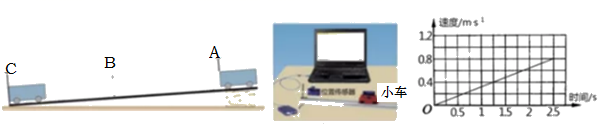

# Physics - 题目 271

**ID**: 830e706bc3b54c1c955e98455fed62a1
**年级**: Grade 9
**难度**: Medium-Hard
**题型**: Experiment

## 题目
小明同学用如图的装置研究小车在斜面上的运动．他将小车从坡顶A处静止释放，测出小车从A滑到坡底C处的时间t_{1}＝2.​​​​​​​‌6s；再次将小车从A处静止释放，测出小车从A滑到中点B处的时间t_{2}＝1.8s．（1）通过小明的测量数据可以判断，小车在前半程的平均速度全程的平均速度．（选填：大于、等于、小于）（2）小明想测量小车在整个运动过程中后半段的平均速度，他应该将小车从处静止释放，并在B处开始计时，在C处停止计时．（选填：A、B）（3）物体运动的情况还可以通过另一种办法即时测定、显现出来．位置传感器利用超声波测出不同时刻小车与它的距离，计算机就可以算出小车在不同位置的速度（如中图）．屏幕图象如右图所示，横轴为时间，纵轴为速度，通过图象可以看出小车在斜面上滑下时是（选填：匀速、加速）运动的；小车到达坡底时的速度为m/s．

## 解答

1. （1）设全程路程为L，则小车运动的距离s_{AC}＝L， $s{{}_{AB}}=\frac {1}{2}L$ ，又因为所用的时间是：t_{AC}＝2.6s，t_{AB}＝t_{2}＝1.8s，所以，小车在前半程的平均速度是： $v{{}_{AB}}=\frac {s{{}_{AB}}}{t{{}_{AB}}}=\frac {\frac {1}{2}L}{1.8s}=\frac {L}{3.6s}$  ；
2. 小车运动全程的平均速度是：_{ }$v{{}_{AC}}=\frac {s{{}_{AC}}}{t{{}_{AC}}}=\frac {L}{2.6s}$_{ }；即v_{AB}＜v_{AC}，所以AB段的平均速度小于全程的平均速度；
3. （2）在测量小车在整个运动过程中后半段的平均速度，他应该将小车从A处静止释放，并在B处开始计时，在C处停止计时；
4. （3）由于匀加速直线运动的v﹣t图象是一条向上倾斜的直线，所以，小车在斜面上滑下时是加速运动的；小车到达坡底时的时间是25s，对应的速度为0.8m/s．

## 知识点

**中文**:
  - 测量物体运动的平均速度

**English**:
  - Measuring Average Velocity of an Object

---
