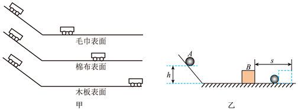

# Physics - 题目 2423

**ID**: 84bab632845d4f12a5c36729f2b6f1b1
**年级**: Grade 9
**难度**: Medium-Hard
**题型**: Experiment

## 题目
斜面在物理实验中多次使用。​​​​​​​‌如图甲所示为探究“阻力对物体运动的影响”的斜面，图乙为探究“物体动能的大小与哪些因素有关”的斜面。（1）在这两个实验中，斜面的作用都是。（2）在甲图中通过来判断小车所受阻力的大小；乙图中通过来判断小球动能的大小。（3）若用木块代替图甲中的小车来探究“摩擦力的大小与什么因素有关”，还需要添加的器材是钩码和。（4）在以上实验中，都用到了和的实验方法。

## 解答

1. （1）[1]小车和小球从斜面上滚下，到达水平面时会有一定的速度，故斜面的作用是使小车和小球具有一定的初速度。
2. （2）[2][3]小车在不同的表面运动的距离不同，说明受到的阻力不同；球把木块推出的距离长，说明的物体对外做的功多，说明球的动能越大。
3. （3）[4]如果要探究摩擦力的大小与什么因素有关是我们应想到，可能与物体的重力有关。所以应测得物体的重力。需要弹簧测力计。
4. （4）[5][6]根据小车运动的距离来判定阻力的大小，小球的动能大小不易观察，可以通过观察木块被移动的距离来比较动能的大小，都采用了转换法；影响阻力对物体运动的影响和动能大小的因素时，也运用了控制变量法。

## 知识点

**中文**:
  - 探究影响物体动能大小因素的实验
  - 阻力对物体运动影响的探究实验

**English**:
  - Experiment: Factors Affecting Kinetic Energy
  - Experiment: Effect of Resistance on Motion

---
