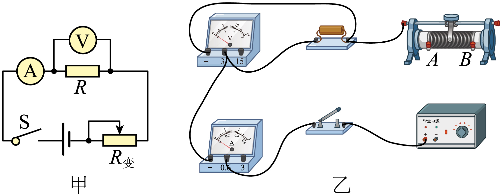

# Physics - 题目 2909

**ID**: 858a05195d594f09bbfc942851765b19
**年级**: Grade 9
**难度**: Medium-Hard
**题型**: Experiment

## 题目
现有下列器材：学生电源（6V）、电流表（0 $\sim $ 0.6A）、电压表（0 $\sim $ 3V）、定值电阻（5Ω、10Ω、20Ω各一个）、滑动变阻器（100Ω  0.5A），开关和导线若干，利用这些器材探究“电流与电压、电阻的关系”。​​​​​​​‌（1）请根据图甲所示的电路图用笔画线代替导线将图乙所示的实物连接成完整电路（要求滑片向右滑时，电流表示数变大）；（2）小敏同学探究电流跟电压的关系，他连好电路后，闭合开关，移动滑动变阻器滑片P，电流表有示数，电压表无示数，则故障可能是；（3）小敏同学排除故障后闭合开关，他调节滑动变阻器，测出通过定值电阻为5Ω的电流和对应的电压值，如下表所示，分析数据后发现表格中电流与电压不成正比，检查两电表均无故障，你认为可能的原因是。排除上述原因后，实验结论是：；U/V0.51.01.52.02.5I/A0.120.220.320.420.52（4）小敏同学接着探究电流跟电阻的关系，他依次接入5Ω、10Ω、20Ω三个定值电阻。实验中他先接入5Ω，调节滑动变阻器的滑片，保持电压表示数为2V不变，记下电流表的示数，然后断开开关，用10Ω定值电阻时替换5Ω，如果要保持电压表示数不变滑动变阻器的滑片应该向端（选填“A”或“B”）移动，两次电路的总功率之比为；（5）小敏只用电阻箱代替定值电阻实验，且其他连接方式不变。若保持电阻箱两端的电压为2V，为能完成实验，电阻箱可接入电路的阻值范围是Ω至Ω。

## 解答

1. （1）要求滑片向右滑时，电流表示数变大，故应将电阻与滑动变阻器右下接线柱相连，如下图所示：
2. 
3. （2）电流表有示数，说明电路为通路，电压表没示数，说明电压表被短路，因此故障为定值电阻R短路。
4. （3）分析表格中数据可知，电流值都去掉0.02A时，电流值与电压值成正比，所以，可能的原因是电流表使用前没有调零。
5. 排除上述原因后，分析标准数据可知，在电阻一定的情况下，通过导体的电流和导体两端的电压成正比。
6. （4）根据串联电路的分压原理可知，将定值电阻由5Ω改接成10Ω的电阻，电阻增大，其分得的电压增大，探究电流与电阻的实验中应控制电压不变，根据串联电路电压的规律可知，为了保持定值电阻两端电压不变，应增大滑动变阻器分得的电压，由串联分压的分压原理可知，应增大滑动变阻器连入电路中的电阻，所以，滑片应向A端移动，使电压表的示数为2V不变。
7. 实验中接入5Ω，电压表示数为2V，则此时电流
8. 为
9. $I{{}_{1}}=\frac {U^{′}}{R{{}_{1}}}=\frac {2{\rm{V}}}{5{\rm{Ω}}}=0.4{\rm{A}}$
10. 当实验中接入10Ω，电压表示数仍为2V，则此时电
11. 流为
12. $I{{}_{2}}=\frac {U^{′}}{R{{}_{2}}}=\frac {2{\rm{V}}}{10{\rm{Ω}}}=0.2{\rm{A}}$
13. 则两次电路的总功率之比为
14. $\frac {P{{}_{1}}}{P{{}_{2}}}=\frac {UI{{}_{1}}}{UI{{}_{2}}}=\frac {I{{}_{1}}}{I{{}_{2}}}=\frac {0.4{\rm{A}}}{0.2{\rm{A}}}=\frac {2}{1}$
15. （5）保持电阻箱两端的电压为
16. $U{{}_{箱}}=2{\rm{V}}$
17. 则滑动变阻器两端的电压为
18. $U{{}_{滑}}=U-U{{}_{箱}}=6{\rm{V}}-2{\rm{V}}=4{\rm{V}}$
19. 当滑动变阻器连入电路为100Ω时时，电路中的电流为
20. $I{{}_{3}}=\frac {U{{}_{箱}}}{R{{}_{最大}}}=\frac {4{\rm{V}}}{100{\rm{Ω}}}=0.04{\rm{A}}$
21. 此时电阻箱接入电路的电阻为
22. $R{{}_{箱1}}=\frac {U{{}_{箱}}}{I{{}_{3}}}=\frac {2{\rm{V}}}{0.04{\rm{A}}}=50{\rm{Ω}}$
23. 由滑动变阻器的规格可知，电路中最大电流为
24. $I{{}_{4}}=0.5{\rm{A}}$
25. 此时电阻箱接入电路的电阻为
26. $R{{}_{箱2}}=\frac {U{{}_{箱}}}{I{{}_{4}}}=\frac {2{\rm{V}}}{0.5{\rm{A}}}=4{\rm{Ω}}$
27. 电阻箱可接入电路的阻值范围是
28. $4\sim 50Ω$

## 知识点

**中文**:
  - 电流与电压关系的探究实验
  - 电流与电阻关系的探究实验

**English**:
  - Experiment: Relationship between Current and Voltage
  - Experiment: Relationship between Current and Resistance

---
