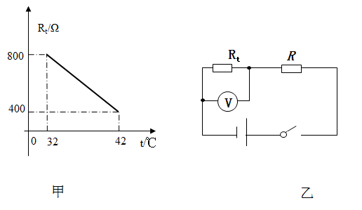

# Physics - 题目 877

**ID**: 8a594a0111174a159f26688f078d9a35
**年级**: Grade 9
**难度**: Medium-Hard
**题型**: Experiment

## 题目
初三实验小组同学发现实验室有一只温敏电阻Rt，其阻值与温度关系如图甲。​​​​​​​‌该小组想利用此电阻和电表制作一个体温计，设想是温度越高，电表示数越大。可用器材有：电源（电压恒为 6V）、电压表（量程 0~3V）、电流表（量程 0~0.6A）、定值电阻R（200Ω）、开关、导线若干。(1)小组同学首先对使用电流表还是电压表作为温度显示仪进行了讨论，小楷同学指出使用电流表无法显示温度的变化，其主要原因是；(2)小楷设计了如图乙的电路，并对该电路进行了说明，你认为下列说法中正确的是；

## 解答

1. (1)[1]由电路图可知，温敏电阻值很大，且与温度呈线性变化关系，电源电压恒为6V，电路中的电流很小，故使用0~0.6A量程的电流表不能明显显示电流的变化。
2. (2)[2]小楷设计了如图乙的电路，两个电阻串联，电压表测量温敏电阻两端电压，温度升高时温敏电阻阻值变小，电路电流变大，温敏电阻两端电压变小，则其表达示为
3. $U{{}_{t}}=\frac {R{{}_{t}}}{R{{}_{t}}+R}U=\frac {1}{1+\frac {R}{R{{}_{t}}}}U$
4. 故电压表示数随温度的升高而减小，且电压表示数随温度的变化是不均匀的；R的主要作用是分压实现电压表示数变化；根据串联电阻分压特点
5. $\frac {U{{}_{t}}}{U}=\frac {R{{}_{t}}}{R{{}_{t}}+R}$
6. 则当 $R{{}_{t}}>R$ 时，电压表超量程；故选B。
7. (3)[3]由图可推导出与的关系
8. $R{{}_{t}}=-40t+2080$
9. 当正常人腋窝温度为37℃时，Rt阻值为
10. $R{{}_{t}}=-40\times 37+2080=600{\rm{Ω}}$
11. 闭合S，当电压表示数稳定后，电压表示数应为
12. $U^{′}=\frac {R}{R{{}_{t}}+R}U=\frac {{\rm{2}}00{\rm{Ω}}}{600{\rm{Ω}}+{\rm{2}}00{\rm{Ω}}}\times {\rm{6}}{\rm{V}}=1.5{\rm{V}}$
13. (4)[4]电压表示数表达示为
14. $U{{}_{R}}=\frac {1}{1+\frac {R{{}_{t}}}{R}}U$
15. 电压变化量为
16. $\Delta U{{}_{R}}=(\frac {1}{1+\frac {R{{}_{t}}}{R+\Delta R}}-\frac {1}{1+\frac {R{{}_{t}}}{R}})U$
17. 如果想要电压表更加明显地显示温度的变化，即在可测温度范围内，将电源电压适当调大，或将R换成阻值更大且适当的定值电阻，或保持其他部分不变，在Rt两端并联一个阻值适当的定值电阻（增大定值电阻分压比例），则电压表指针偏转角度会更大；故A、C、E符合题意。

## 知识点

**中文**:
  - 电路的动态分析

**English**:
  - Dynamic Circuit Analysis

---
