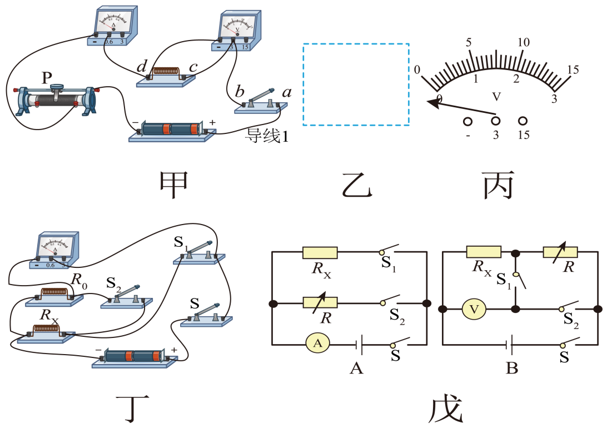

# Physics - 题目 2993

**ID**: 94037c9f0b954553b6aa72baf3e6c4ff
**年级**: Grade 9
**难度**: Medium-Hard
**题型**: Experiment

## 题目
小虎用如图甲所示的电路探究电流与电压关系。​​​​​​​‌（1）请根据图甲的电路连接情况，在图乙虚线框内画出对应的电路图；（2）开关闭合前，小虎发现电压表指针位置如图丙所示，接下来小虎要对电压表进行的操作是；（3）开关闭合后，实验中发现电流表无示数。为查找问题，先将导线1从a点断开，然后依次去接触d点、c点、b点及a点，发现当接触d点、c点时，电流表有示数，则电路故障不可能是下列选项中的；

## 解答

1. （1）由图甲知，滑动变阻器、电流表、R_{x}、开关依次连接在电源两极间，电压表并联在R_{x}两端，据此画出电路图如图所示：
2. 
3. （2）连接电路前，要保证电压表的表盘指针指在零刻度处，图丙中指针反偏，所以要把电压表调零。
4. （3）BC．实验中发现电流表无示数，则电路出现了断路现象；将导线1从a点断开，然后依次去接触d点、c点、b点及a点，发现当接触d点、c点时，电流表有示数，说明电阻和滑动变阻器没有问题，故BC符合题意；
5. A．接触b点和a点时，电流表无示数，这说明故障是开关断路，故A不符合题意。
6. 故选BC。
7. （4）由表格数据可得，电压与电流的比值 $\frac {U}{I}=\frac {0.5{\rm{V}}}{0.1{\rm{A}}}=\frac {1{\rm{V}}}{0.2{\rm{A}}}=\frac {1.5{\rm{V}}}{0.3{\rm{A}}}=\frac {2.0{\rm{V}}}{0.4{\rm{A}}}=\frac {2.5{\rm{V}}}{0.5{\rm{A}}}$ ，因电压与电流之比为定值，故得出在电阻不变时，导体中的电流与导体两端的电压成正比。
8. （5）①当开关S闭合，S_{1}、S_{2}断开时，电路中只有电阻R_{0}工作，电流表示数为I_{1}，此时电源电压U=I_{1}R_{0}
9. ②当开关S、S_{2}闭合，S_{1}断开时，电路中R_{1}和R_{2}并联，电流表测量干路电流，电流表示数为I_{2}，根据串联电路电流规律可知，待测电阻的电流I_{x}=I_{2}-I_{1}，则待测电阻 $R{{}_{{\rm{x}}}}=\frac {U{{}_{{\rm{x}}}}}{I{{}_{{\rm{x}}}}}=\frac {I{{}_{1}}R{{}_{0}}}{I{{}_{2}}-I{{}_{1}}}$
10. （6）A方案中闭合开关S_{1}，电路为电阻的简单电路，电源电压3V，电阻阻值为数百欧，通过电路的电流小于电流表的分度值，电流表无法准确测量通过电路的电流，所以无法准确测量未知电阻的阻值。B方案两电阻串联接入电路，闭合开关S_{2}，电压表测两电阻的总电压U，闭合开关S_{1}，电压表测电阻R_{x}，两端的电压U_{x}，串联电路总电压等于各分电压之和，则电阻箱两端的电压为U-U_{x}，由串联分压原理可知 $\frac {R{{}_{{\rm{x}}}}}{R}=\frac {U{{}_{{\rm{x}}}}}{U-U{{}_{{\rm{x}}}}}$ ，所以 $R{{}_{{\rm{x}}}}=\frac {U{{}_{{\rm{x}}}}R}{U-U{{}_{{\rm{x}}}}}$ ，所以B方案能准确测量Rx阻值。

## 知识点

**中文**:
  - 其他方法测电阻
  - 电流与电压关系的探究实验

**English**:
  - Other Methods for Measuring Resistance
  - Experiment: Relationship between Current and Voltage

---
