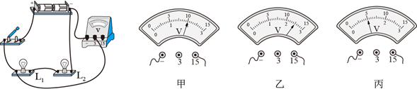
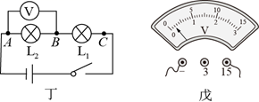

# Physics - 题目 1889

**ID**: 9a03690e0f624679b79b02bdbb419480
**年级**: Grade 9
**难度**: Medium-Hard
**题型**: Experiment

## 题目
如图所示是同学们在探究串并联电路电流电压规律实验的实物连线｡(1)小明一组认为：为了使探究得出的结论具有普遍意义，L_{1}、L_{2}应该选择（选填“相同或“不相同”）的小灯泡｡则如图的连接方式中电压表测的电压是电压；若测得的电压如图甲乙丙所示，则这时图可能是此时电压表的读数｡(2)为了测L_{1}两端的电压，只去掉一条连接线，并在此根连接线上打“×”，然后用黑色笔重新画上一根正确的连接的导线｡则图可能是此时电压表的读数｡(3)接下来小明一组根据图丁连接好电路，未闭合开关，电压表示数如图戊所示，小明接下来的操作是｡小明解决了上面的问题继续实验，闭合开关电压表示数如图戌所示，为了使实验结果更准确，接下来他应该｡(4)测量完成后，进行小组交流讨论，如表选录了四个小组的数据进行分析而不用一个小组的数据，你认为这样做的理由是｡实验小组L_{1}两端的电压/VL_{2}两端的电压/V串联总电压/V11.​​​​​​​‌43.14.523.01.34.431.11.72.941.81.23.0

## 解答

1. (1)[1] [2] [3]探究串并联电流电压的规律实验，为了使结论具有普遍性，即普遍存在的，故应该选择不同的电灯泡；由于电压表并联在L_{1}､L_{2}的两端，或者直接并联在电源两端，故测L_{1}､L_{2}（或电源电压）电压；由于该电压表测的是电源电压，而此实物图中只有两节干电池，此电压应该是小于等于3V，丙图电压太小，乙图电压示数太大，故甲图最合适。
2. (2)[4]由于测量L_{1}两端的电压，故电压表需要并联在L_{1}两端，从正接线柱接入，从负接线柱接出，而此时电压表是正接线柱接入，经过电压表，从负接出，并连接到灯泡L_{1}右端，故电路图如图所示
3. 
4. [5]由于串联，各用电器的电压之和为电源电压，故小于甲表的示数即可，故此时丙图的电压最小。
5. (3)[6] [7]未闭合开关，电压表示数如图戊所示，即指针没有指向零，故先将指针调零。解决了上面的问题继续实验，闭合开关电压表示数如图戌所示，电压表的指针偏转过小，需要更换小量程。
6. (4) [8]在实验题中，要做多组实验，使结论具有普遍性。

## 知识点

**中文**:
  - 探究串、并联电路中的电压规律实验
  - 探究串、并联电路的电流规律实验

**English**:
  - Experiment: Voltage Laws in Series/Parallel
  - Experiment: Current Laws in Series/Parallel

---
