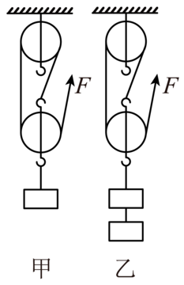

# Physics - 题目 2548

**ID**: 9a11fdd4a29a4167b4d9c399f3764591
**年级**: Grade 9
**难度**: Medium-Hard
**题型**: Experiment

## 题目
小东在探究影响滑轮组机械效率高低的因素时，设计了如图所示的两个滑轮组，分别测量两次实验的动滑轮重G_{动}、 钩码总重G、 钩码上升高度h、 绳子自由端拉力F、 绳子自由端移动距离s，计算出相应的机械效率η，并将它们填入下表中．G_{动}/NG/Nh/mF/Ns/mη甲1.​​​​​​​‌02.00.11.10.360.6%乙1.04.00.11.80.374.1%（1）实验中，测机械效率的原理是η=；（2）在如图乙的实验中，滑轮组提升物体所做的有用功为J；（3）分析表中数据，可知：对于同一动滑轮，所提升的钩码越重，机械效率；（4）分析表中数据可知， ${\rm{F}}\ne \frac {G{{}_{物}}+G{{}_{动}}}{2}$ ，排除测量因素的影响，主要原因是；（5）生活中利用滑轮组提升重物时，提高其机械效率的方法有哪些？（写出一种即可）．

## 解答

1. （ 1）测机械效率的原理是η＝ $\frac {Gh}{Fs}$ 。
2. （2）由表中实验数据可知，滑轮组提升物体所做的有用功为:
3. W＝  $Gh$ ＝4.0N $\times $ 0.1m＝0.4J
4. （3）由表中实验数据可知，对于同一动滑轮，所提升钩码的重力增大，机械效率将增大。
5. （4）由于滑轮与轮轴间存在摩擦、缠绕滑轮组的绳子有重力,因此：F≠ $\frac {G{{}_{物}}+G{{}_{动}}}{2}$
6. （5）提高滑轮组机械效率的方法：减小动滑轮质量（或减小滑轮与轴之间的摩擦等）。

## 知识点

**中文**:
  - 滑轮（组）的机械效率及其计算
  - 滑轮（组）的机械效率的测量实验

**English**:
  - Mechanical Efficiency of Pulleys and Calculations
  - Experiment: Measuring Mechanical Efficiency of Pulleys

---
