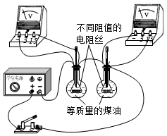

# Physics - 题目 2712

**ID**: 9a281f5632c445cd8ff7d0c96dd287ca
**年级**: Grade 9
**难度**: Medium-Hard
**题型**: Experiment

## 题目
在探究“电流做功与哪些因素有关”的实验中：(1)如图所示，两个相同的瓶中装了质量相同的煤油，这样就可以利用煤油升高的温度来间接表示有多少电能转化为能。​​​​​​​‌两个瓶子中的电阻丝是（填“串联”或“并联”）接人电路的，这样做可以保持两瓶中一致。这是用来研究电流所做的功跟（填“电流”或“电压”）的关系的，这种研究方法通常叫做。实验的结果表明，相同时间内电压大的那瓶煤油温度升高得多，说明电流做功跟有关。(2)通电时间越长，瓶中煤油的温度升得越高，这表明电流做功还跟有关系。

## 解答

1. (1)[1]两个相同的瓶中装了质量相同的煤油，这样就可以利用煤油升高的温度来间接表示有多少电能转化为内能。
2. [2][3]要保证流经两瓶子内的电流相等，故两个瓶子中的电阻丝是串联接人电路的，这样做可以保持两瓶中通过的电流一致。
3. [4][5]这是用来研究电流所做的功跟电压的关系的，从串联和并联电路的电路的特点可知，要想使通过两瓶中电阻丝的电流和通电时间相等，应让两电阻丝串联，并且在此利用控制变量法，研究电流做的功与电压的关系，这种研究方法通常叫做控制变量法。
4. [6]实验的结果表明，相同时间内电压大的那瓶煤油温度升高得多，说明电流做功跟电压有关。
5. (2)[7]由题意知，通电时间越长，瓶中煤油的温度升得越高，这表明电流做功还跟通电的时间有关系。

## 知识点

**中文**:
  - 影响电流热效应因素的探究实验

**English**:
  - Experiment: Factors Affecting Heating Effect

---
