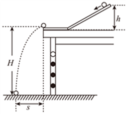

# Physics - 题目 1101

**ID**: 9bac02406b7b476881f3a51724a52295
**年级**: Grade 9
**难度**: Medium-Hard
**题型**: Experiment

## 题目
小明和小军注意到钢球从桌子上不小心就会滚到桌下，落地点时远时近。​​​​​​​‌如图，小军查阅资料了解到：若运动着的钢球从桌上滚落后，钢球的落地点到桌子的水平距离可能与斜面的粗糙程度、钢球的下落高度H、钢球离开桌面的速度大小有关。小明猜想：钢球的落地点到桌子的水平距离与钢球离开桌面的速度大小有关，请设计实验验证小明的猜想（1）除图中所示的器材外，实验还需要的测量工具：。（2）写出实验步骤（可用画图或文字表述）和画出记录数据的表格。

## 解答

1. （2）[2]实验步骤：保持球台的高度不变，使同一小球从斜面的不同高度滚下，其目的是是钢球到达桌面的速度不同，测量出小球的落地点到球台的水平距离。实验中需要记录钢球下降的高度和，钢球的落地点到桌子的水平距离，表格如下：
2. 同一钢球，桌子高度相同
3. 次数
4. 小球高度h/m
5. 落地点到桌子的水平距离s/m
6. 1
7. 2
8. 3

## 知识点

**中文**:
  - 物理常识及物理学史

**English**:
  - General Physics Knowledge and History

---
