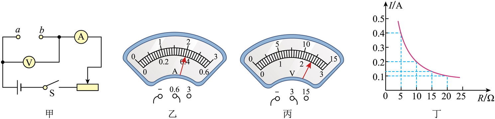

# Physics - 题目 2543

**ID**: 9de3b63a21254df0820ae9e1f4e93ed5
**年级**: Grade 9
**难度**: Medium-Hard
**题型**: Experiment

## 题目
某小组为了探究“电流与电阻的关系”，设计了如图甲的实验电路，他们在学校实验室找来了如下一些实验器材：电压恒为3V的电源，电流表、电压表各一只，一个开关，阻值分别为5Ω、10Ω、15Ω、20Ω的定值电阻各一个，滑动变阻器上标有“20Ω　1A”字样，导线若干。​​​​​​​‌（1）闭合开关前，应将图中滑动变阻器的滑片置于最端（选填“左”或“右”）；闭合开关后发现电压表有示数，但电流表无示数，此时出现的故障可能是；（2）排除故障后闭合开关，调节滑动变阻器的滑片，使电压表的读数为2V，电流表示数如图乙所示，所用的定值电阻为Ω；接着断开开关，改换另一电阻继续做实验，闭合开关，电压表示数如图丙所示，接下来应向（选填“左”或“右”）调节滑动变阻器的滑片，使电压表的示数为2V；（3）小组同学在某次实验中，将定值电阻的阻值由10Ω换为15Ω后闭合开关，直接读出电流表的示数，这个示数可能是（      ）

## 解答

1. （1）闭合开关前，为了保护电路，滑动变阻器应移至阻值最大处，即最右端。
2. 图中是串联电路，闭合开关后无电流，说明电路发生断路，电压表有示数，则与电压表并联的定值电阻发生断路，此时电压表串联接入电路，因此有示数。
3. （2）根据题意，定值电阻两端电压为2V，乙图中电流表的量程是0-0.6A，分度值是0.02A，读数为0.4A，即电路中的电流是0.4A，则定值电阻的阻值为 $R=\frac {U}{I}=\frac {2{\rm{V}}}{0.4{\rm{A}}}=5{\rm{Ω}}$ ；丙图中电压表的量程是0-3V，分度值是0.1V，读数为2.4V，探究电流与电阻关系的实验中需要保持电压不变，即电压表的示数应调为2V，由串联电压规律可知，需要将滑动变阻器两端电压变大，根据串联分压原理，滑动变阻器的阻值变大，即滑片向右移动。
4. （3）当定值电阻为10Ω时，电路中的电流为 $I^{′}=\frac {U}{R^{′}}=\frac {2{\rm{V}}}{10{\rm{Ω}}}=0.2{\rm{A}}$ ，滑动变阻器接入电路中的阻值为 $R{{}_{P}}=\frac {U{{}_{P}}}{I}=\frac {U-U{{}_{V}}}{I}=\frac {3{\rm{V}}-2{\rm{V}}}{0.2{\rm{A}}}=5{\rm{Ω}}$ ，将定值电阻的阻值由10Ω换为15Ω后闭合开关，此时滑动变阻器接入电路中的阻值不变，此时电路中的总电阻为 $R{{}_{总}}=R^{′}+R{{}_{P}}=15{\rm{Ω}}+5{\rm{Ω}}=20{\rm{Ω}}$ ，电路中的电流为 $I{{}_{总}}=\frac {U{{}_{总}}}{R{{}_{总}}}=\frac {3{\rm{V}}}{20{\rm{Ω}}}=0.15{\rm{A}}$ ，故B符合题意，ACD不符合题意。
5. （4）根据丁图分析可知，当电压一定时，电阻越大，电路越小，即当电压一定时，电流与电阻成反比。

## 知识点

**中文**:
  - 电流与电阻关系的探究实验

**English**:
  - Experiment: Relationship between Current and Resistance

---
