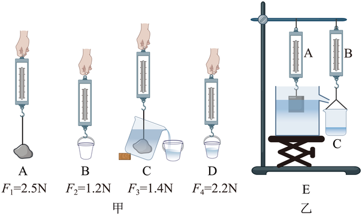

# Physics - 题目 224

**ID**: a12147bffd524574a1148d37a38d800e
**年级**: Grade 9
**难度**: Medium-Hard
**题型**: Experiment

## 题目
某班物理实验小组的同学，在实验中验证阿基米德原理。​​​​​​​‌（1）方案一：小明用石块按照如图甲所示的实验步骤进行实验，为减小测量误差并使操作最简便，最合理的操作步骤应该是；（单选）①ACDB　　②ABCD　　③BACD　　④CADB（2）由图甲可知，石块浸没在水中时，排开水的重力 $G{{}_{排}}=$N，发现 $F{{}_{浮}}$  $\ne G{{}_{排}}$ ，造成这种结果的原因可能是（选填“A”或“B”）；

## 解答

1. （1）为了减小测量误差并使操作最简便，应先测出空桶的重力，再测出石块的重力，这样可以减少更换弹簧测力计测量对象的次数，所以最合理的操作步骤应该是BACD，故选③。
2. （2）由图甲步骤B可知，空桶的重力为1.2N，由步骤D可知，排开的水与桶的总重力为2.2N，所以排开水的重力为 $2.2{\rm{N}}-1.2{\rm{N}}=1{\rm{N}}$
3. A．若最初溢水杯中的水未装至溢水口，则会使测出的石块排开水的重力偏小，从而使 $F{{}_{浮}}$  $\ne G{{}_{排}}$ ，故A符合题意；
4. B．若整个实验过程中，弹簧测力计都没有校零，则分别在计算F_{浮}与G_{排}的过程中，得出的结果与校零情况下的测量结果是相同的，所以不会影响测量结果，故B不符合题意。
5. （3）随着重物没入水中的体积越来越大，则重物所受浮力越来越大，由称重法可知， $F{{}_{浮}}=G-F{{}_{示}}$ ，所以弹簧测力计A的示数在减小。
6. 重物没入水中，溢出的水流到溢水杯右边的烧杯中，使得弹簧测力计B的示数变大，由于溢水杯装满水，重物排开的水全部流入到烧杯中，因此弹簧测力计A的示数变化量等于弹簧测力计B的示数变化量，由于弹簧测力计A的示数减小量就等于重物受到的浮力，弹簧测力计B的示数增加量就等于物体排开水的重力，从而验证了阿基米德原理即 $F{{}_{浮}}=G{{}_{排}}$ 。
7. （4）由图乙中弹簧测力计A的示数为 $2{\rm{N}}$ 可得，浸入水中的物块受到的浮力为 $F{{}_{浮}}=G-F{{}_{示}}=5{\rm{N}}-2{\rm{N}}=3{\rm{N}}$
8. 由阿基米德原理可得，排开水的体积为 $V{{}_{排}}=\frac {F{{}_{浮}}}{ρ{{}_{水}}g}=\frac {{{3}}{\rm{N}}}{1\times {{1}}{{0}}{^{3}}{\rm{k}}{\rm{g}}/{\rm{m}}{^{3}}\times 10{\rm{N}}/{\rm{k}}{\rm{g}}}=3\times 10{^{-4}}{\rm{m}}{^{3}}=300{\rm{c}}{\rm{m}}{^{3}}$
9. 物体浸入水中的深度为 $h=\frac {V{{}_{排}}}{S}=\frac {300{\rm{c}}{\rm{m}}{^{3}}}{50{\rm{c}}{\rm{m}}{^{2}}}=6{\rm{c}}{\rm{m}}$
10. 由题意可知，弹簧测力计的示数变化量为3N，故可得弹簧长度的变化量为为 $\Delta h=\frac {3{\rm{N}}}{1{\rm{N}}}\times 0.5{\rm{m}}=1.5{\rm{c}}{\rm{m}}$
11. 所以装置抬高的高度为 $h{{}_{抬}}=h+\Delta h=6{\rm{c}}{\rm{m}}+1.5{\rm{c}}{\rm{m}}=7.5{\rm{c}}{\rm{m}}$

## 知识点

**中文**:
  - 实验探究阿基米德原理

**English**:
  - Experiment: Investigating Archimedes' Principle

---
