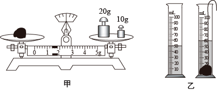
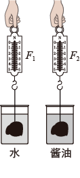
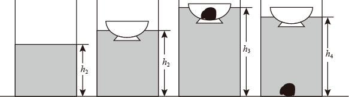

# Physics - 题目 1870

**ID**: a7363df51b9b4ed098bd60110afbb142
**年级**: Grade 9
**难度**: Medium-Hard
**题型**: Experiment

## 题目
利用图中器材测量石块和酱油的密度。​​​​​​​‌（1）使用调节好的天平测量石块质量，天平平衡时，如图中甲所示，则石块的质量是g；（2）将石块浸没在有水的量筒中，如图中乙所示则石块的密度为kg/m^{3}；（3）如图所示，把重为G的石块挂在弹簧测力计下，将石块分别浸没在水和酱油中，石块没有碰到容器底和容器壁，测力计的示数分别为F_{1}和F_{2}，则石块在水中所受浮力的表达式为F_{水浮}=，酱油密度的表达式ρ_{酱}_{油}=（以上两空均用符号表示，忽略细线的质量和体积，水的密度用ρ_{水}表示）；（4）用图所示的方法，测量石块的密度，则石块的密度表达式为ρ_{石}=（用符号表示，水的密度用ρ_{水}表示）

## 解答

1. （1）[1]图甲中天平游码标尺的分度值为0.2g，示数为1.4g，则所测石块的质量是
2. m=20g+10g+1.4g=31.4g
3. （2）[2]图乙原来量筒中水的体积为50mL，后来石块和水的总体积为60mL，则石块的体积为
4. V=60mL-50mL=10mL=10cm^{3}
5. 则石块的密度为
6. ρ= $\frac {m}{V}=\frac {{\rm{3}}{\rm{1}}{\rm{.}}{\rm{4}}{\rm{g}}}{{\rm{1}}{\rm{0}}{\rm{c}}{\rm{m}}{^{{\rm{3}}}}}{\rm{=}}$ 3.14g/cm^{3}=3.14×10^{3}kg/m^{3}
7. （3）[3]石块重力为G，浸没在水中时的测力计的示数为F_{1}，根据称重法测浮力，石块在水中所受浮力的表达式为
8. F_{水浮}=G-F_{1}
9. [4]石块排开酱油的体积等于排开水的体积，为
10. V_{排油}=V_{排水}= $\frac {F{{}_{水浮}}}{ρ{{}_{水}}g}=\frac {G-F{{}_{1}}}{ρ{{}_{水}}g}$
11. 根据阿基米德原理，石块在酱油中所受浮力为
12. F_{油浮}=ρ_{酱}_{油}gV_{排油}
13. 根据称重法测浮力，石块在酱油中所受浮力为
14. F_{油浮}=G-F_{2}
15. 则酱油的密度为
16. ρ_{酱}_{油}= $\frac {F{{}_{油浮}}}{gV{{}_{排油}}}=\frac {G-F{{}_{2}}}{g\frac {G-F{{}_{1}}}{ρ{{}_{水}}g}}=\frac {G-F{{}_{2}}}{G-F{{}_{1}}}ρ{{}_{水}}$
17. （4）[5]设容器底面积为S。由图可知，石块沉入水底前后的水面高度变化量为h_{4}-h_{2}，则石块的体积为
18. V_{石}=S(h_{4}-h_{2})
19. 石块在碗中漂浮前后的水面高度变化量为h_{3}-h_{2}，则石块受到的浮力为
20. F_{浮}=ρ_{水}gV_{排}=ρ_{水}gS(h_{3}-h_{2})
21. 根据漂浮条件，则石块的重力为
22. G_{石}=F_{浮}=ρ_{水}gS(h_{3}-h_{2})
23. 石块的质量为
24. m_{石}= $\frac {G{{}_{石}}}{g}=\frac {ρ{{}_{水}}gS\left ({h{{}_{3}}-h{{}_{2}}}\right )}{g}=ρ{{}_{水}}S\left ({h{{}_{3}}-h{{}_{2}}}\right )$
25. 石块的密度为
26. ρ_{石}= $\frac {m{{}_{石}}}{V{{}_{石}}}=\frac {ρ{{}_{水}}S\left ({h{{}_{3}}-h{{}_{2}}}\right )}{S\left ({h{{}_{4}}-h{{}_{2}}}\right )}=\frac {h{{}_{3}}-h{{}_{2}}}{h{{}_{4}}-h{{}_{2}}}ρ{{}_{水}}$

## 知识点

**中文**:
  - 利用浮力知识测密度
  - 固体密度的测量实验
  - 液体密度的测量实验

**English**:
  - Measuring Density using Buoyancy
  - Experiment: Measuring Density of Solids
  - Experiment: Measuring Density of Liquids

---
