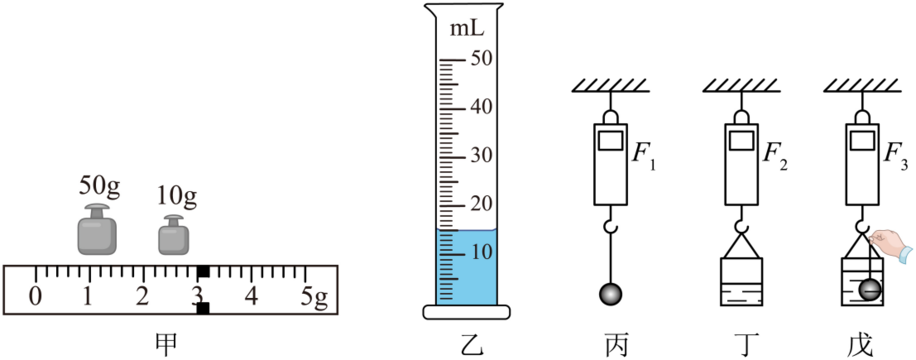

# Physics - 题目 1306

**ID**: a8d178b7693b46a9af1f41007035b6af
**年级**: Grade 9
**难度**: Medium-Hard
**题型**: Experiment

## 题目
学习了密度的测量知识后，小致同学想自己做实验测量小石块的密度，于是从实验室借来仪器进行实验：（1）天平平衡时，右盘中砝码和游码位置如图甲所示，则小石块的质量为g。​​​​​​​‌（2）将小石块取下后，用细线将石块系住，慢慢放入如图乙所示的量筒内，发现水面上升到45mL处，小石块的体积为${\rm{c}}{\rm{m}}{^{{{3}}}}$ ，则小石块的密度为${\rm{g}}{\rm{/}}{\rm{c}}{\rm{m}}{^{{{3}}}}$ ；（3）小致又用电子测力计，对石块的密度重新进行了测量，步骤如下：①先将小石块用细线系好，悬挂在电子测力计的下端，如图丙，待示数稳定后，读出并记为 $F{{}_{1}}$ ；②在小桶里倒入适量的水，悬挂在电子测力计的下端，如图丁，待示数稳定后，读出并记为 $F{{}_{2}}$ ；③再用手提着系着小石块的细线一端，将小石块缓慢地浸没在水中，但要保证石块不触碰小桶底，如图戊所示，待示数稳定后，读出并记为F_{3}。完成以上测量后，根据所得实验数据，请你写出石块密度的表达式： $ρ{{}_{石}}=$（水的密度用 $ρ{{}_{水}}$ 表示）；④若戊图中石块吸水A（石块吸水后体积保持不变），会使密度测量值（选填“偏大”、“偏小”或“不变”）。

## 解答

1. （1）由图甲得，小石块的质量为 $m=50{\rm{g}}+10{\rm{g}}{{+}}3{\rm{g}}{\rm{=}}{{6}}{{3}}{\rm{g}}$ 。
2. （2）由图乙得，量筒的分度值为1mL，量筒中水的体积为15mL；将小石块取下后，用细线将石块系住，慢慢放入如图乙所示的量筒内，发现水面上升到45mL处，小石块的体积为 $V{\rm{=}}V{{}_{总}}{{-}}V{{}_{水}}{\rm{=}}45{\rm{m}}{\rm{L}}{{-}}15{\rm{m}}{\rm{L}}{\rm{=}}30{\rm{m}}{\rm{L}}{\rm{=}}{{3}}{{0}}{\rm{c}}{\rm{m}}{^{3}}$ ，小石块的密度 $ρ=\frac {m}{V}{\rm{=}}\frac {{{6}}{{3}}{\rm{g}}}{{{3}}{{0}}{\rm{c}}{\rm{m}}{^{3}}}{\rm{=}}{{2}}{{.}}{{1}}{\rm{g}}{\rm{/}}{\rm{c}}{\rm{m}}{^{{{3}}}}{\rm{=}}2.1\times 10{^{3}}{\rm{k}}{\rm{g}}/{\rm{m}}{^{3}}$ 。
3. （3）依题意得，石块的重力 $G{{}_{石}}=F{{}_{1}}$ ，石块浸没在水中，排开的水的重力为 $F{{}_{浮}}{\rm{=}}F{{}_{3}}-F{{}_{2}}$ ，此时石块排开水的体积等于石块的体积，由 $F{{}_{浮}}=ρ{{}_{液}}V{{}_{排}}g$ 得 $V{{}_{石块}}=V{{}_{排}}=\frac {F{{}_{浮}}}{ρ{{}_{水}}g}{\rm{=}}\frac {F{{}_{3}}-F{{}_{2}}}{ρ{{}_{水}}g}$ ，由 $G=mg$ 与 $ρ=\frac {m}{V}$ 得，石块的密度为 $ρ{{}_{石}}=\frac {m{{}_{石}}}{V{{}_{石}}}{\rm{=}}\frac {G{{}_{石}}}{gV{{}_{石}}}=\frac {F{{}_{1}}}{g\times \frac {F{{}_{3}}-F{{}_{2}}}{ρ{{}_{水}}g}}=\frac {F{{}_{1}}}{F{{}_{3}}-F{{}_{2}}}ρ{{}_{水}}$ ；若戊图中石块吸水A（石块吸水后体积保持不变），导致石块排开的水的重力变小，即石块浸没在水中的浮力变小，通过阿基米德原理得到，石块排开的水的体积变小，因此得到的石块的体积偏小；石块重力不变，则石块的质量不变，由 $ρ=\frac {m}{V}$ 得，会使密度测量值偏大。

## 知识点

**中文**:
  - 固体密度的测量实验

**English**:
  - Experiment: Measuring Density of Solids

---
