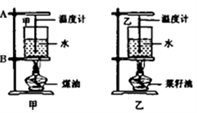
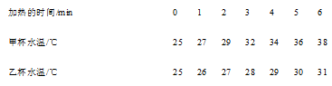

# Physics - 题目 1959

**ID**: a8ebd1863c734a7ab45c1c07f62c5089
**年级**: Grade 9
**难度**: Medium-Hard
**题型**: Experiment

## 题目
某同学学习了燃料的热值后，自己设计了一个实验来探究煤油和菜籽油的热值关系．实验时，他组装了如图所示的两套规格完全相同的装置，点燃两盏油灯，并每隔1min记录了杯中水的温度（见下表）.​​​​​​​‌（1）甲图中，在安装、调整实验器材时，科学合理的顺序是：先调整并固定的位置，再调整并固定的位置（选填 “A”或“B”）.（2）为保证实验结论的可靠性，实验时，除了两套实验装置相同外，还需要控制：①、②.（3）通过表中记录的数据，你认为煤油和菜籽油两种燃料中，热值较大的是.（4）该同学实验前用天平测出了烧杯中水的质量及两油灯中燃料的质量，并根据记录的数据，利用公式Q_{水吸}=c_{水}m_{水}（t－t_{0}）计算出了水吸收的热量，他认为“用这个热量与油料质量的比”就能准确地计算出煤油或菜籽油的热值．你认为他的计算结果可靠吗？，为什么？.

## 解答

1. （1）实验中涉及加热的装置时，应按从下到上的顺序进行，所以安装器材时需要先固定B的位置，然后再调整A的位置．
2. （2）根据控制变量的思想，为了保证实验的可靠性，需要控制水的质量和水的初温相同，保证两酒精灯中油的质量相等．
3. （3）分析表格数据可知，甲杯水的温度升高的较快，即甲酒精灯燃烧产生的热量多，所以煤油的热值大；
4. （4）火焰的热量会大量散失到空气中，不能完全被水吸收，且也不能保证燃料完全燃烧，所以计算出的热值偏小，不可靠．
5. 故答案为 (1). B       (2). A       (3). 两杯中水的质量相等、水的初温相同       (4). 两灯中油的质量相等       (5). 煤油       (6). 不可靠       (7). 油不能完全燃烧或油燃烧后放出的热量不可能全部被水吸收

## 知识点

**中文**:
  - 燃料的热值

**English**:
  - Calorific Value of Fuels

---
