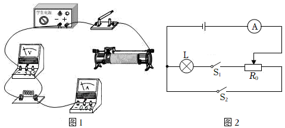

# Physics - 题目 1779

**ID**: ab8bf6a6d35943b1bbd50d575ba1ced2
**年级**: Grade 9
**难度**: Medium-Hard
**题型**: Experiment

## 题目
小明选用如下器材：5Ω、10Ω、15Ω、20Ω、25Ω、30Ω的定值电阻、最大阻值为30Ω的滑动变阻器、学生电源、电流表、电压表、开关导线若干，进行探究。​​​​​​​‌探究“电流与电阻的关系”，电源电压为6V，控制定值电阻两端电压为2.5V。（1）请你帮助小明用笔画线代替导线把图1中的实物电路连接完整。要求：当滑动变阻器的滑片向左移动时，电流表的指针偏转角度变大（注意电流表量程选择）；（2）把5Ω的电阻接入电路，使其两端的电压为2.5V并记下对应的电流值。当把5Ω换为10Ω的电阻后，使其两端的电压恢复到2.5V，此时滑动变阻器连入的阻值，跟原来的相比（选填“变大”或“变小”）；（3）当小明把25Ω的电阻接入电路中时，发现无论怎样调节滑动变阻器的滑片都不能使其两端电压达到2.5V。控制定值电阻两端电压2.5V不变，为保证六个电阻单独接入电路中完成实验，应该换用一个阻值不低于Ω的滑动变阻器；（4）由数据得出结论：当电压一定时，电流与电阻成反比关系。（5）上述实验结束后，小明又设计了如图2所示电路，只用电流表来测量额定电流I额＝0.2A小灯泡的额定功率，已知滑动变阻器的最大电阻R0＝50Ω，电源电压未知，其测量过程如下：①闭合S2，断开S1，移动滑动变阻器的滑片使其连入阻值为最大，并记下电流表的示数I1＝0.12A，则电源电压为V；②（填两开关闭合情况），移动滑动变阻器的滑片使电流表的示数为0.2A，此时灯泡正常发光；③（填两开关闭合情况），保持滑动变阻器的滑片位置不变，记下电流表的示数I2＝0.15A；④则灯泡的额定功率P额＝W。

## 解答

1. （1）[1]由题可知，电压表选择的是0~3V量程，当将最小的定值电阻接入电路且电压表满偏时，电路中的电流最大，为
2. $I=\frac {U}{R{{}_{1}}}=\frac {3{\rm{V}}}{5Ω}=0.6{\rm{A}}$
3. 所以电流表应选择0~0.6A量程。题中要求当滑动变阻器的滑片向左移动时，电流表的指针偏转角度变大，即要求滑动变阻器的滑片向左移动时其连入电路的电阻减小，则应连接左侧的下接线柱。如图所示：
4. 
5. （2）[2]在更换为阻值更大的定值电阻时，电路中的总电阻变大，由欧姆定律可知电路中电流变小，滑动变阻器两端的电压变小，则定值电阻两端的电压变大。此时应增大滑动变阻器接入电路的阻值（即向右移动滑片），使得定值电阻两端的电压达到预设电压2.5V。
6. （3）[3]在更换25Ω的电阻后，由以上分析可知，定值电阻两端的电压将大于2.5V，此时应向右移动滑片。但无论怎样移动滑片，电压表都不能达到2.5V，说明滑动变阻器已经全部连入电路时，电压表的示数仍大于2.5V。在电源电压不变的情况下，我们应更换最大阻值更大的滑动变阻器，且更换的滑动变阻器可以使连入30Ω的电阻时电压表的示数也能调整到2.5V。由串联电路的分压特点可知，当30Ω的电阻接入电路中且电压表示数为2.5V时，滑动变阻器两端的电压为
7. U滑＝U电源-U定值＝6V-2.5V＝3.5V
8. 在串联电路中电流处处相等，则有
9. $I=\frac {U{{}_{定值}}}{R{{}_{6}}}=\frac {U{{}_{滑}}}{R{{}_{滑}}}$
10. 即
11. $\frac {{\rm{2}}{\rm{.}}{\rm{5}}{\rm{V}}}{30Ω}=\frac {3.5{\rm{V}}}{R{{}_{滑}}}$
12. 解得R滑＝42Ω。即滑动变阻器的最大阻值至少为42Ω。
13. （5）①[4]闭合S2，断开S1，移动滑动变阻器的滑片使其连入阻值为最大时，只有滑动变阻器连入电路，则电源电压
14. U′＝I1R0＝0.12A×50Ω＝6V
15. ②[5]要使灯泡发光，开关S1必须闭合。电流表示数为0.2A时灯泡正常发光，说明电流表测的是通过灯泡的电流，则开关S2是断开的。此时滑动变阻器滑片左侧的电阻丝与灯泡串联。
16. ③[6]保持滑动变阻器的滑片位置不变，电流表的示数I2变小，说明电路中的电阻增大了。根据串、并联电路的电流、电阻特点可知，只有闭合S2、断开S1的情况下，才能达到这一目的。
17. [7]此时滑动变阻器滑片右侧的电阻丝连入电路，其阻值为
18. $R{{}_{0}}{{}_{右}}=\frac {U^{′}}{I{{}_{2}}}=\frac {{\rm{6}}{\rm{V}}}{{\rm{0}}{\rm{.}}{\rm{1}}{\rm{5}}{\rm{A}}}=40Ω$
19. 则与灯泡串联部分的滑动变阻器的阻值为
20. R0左＝R0-R0右＝50Ω-40Ω＝10Ω
21. 则灯泡正常发光时，滑动变阻器两端的电压为
22. U滑′＝I额R0左＝0.2A×10Ω＝2V
23. 则灯泡两端的电压为
24. U灯＝U′-U滑′＝6V-2V＝4V
25. 灯泡的电功率为
26. P＝U灯I额＝4V×0.2A＝0.8W

## 知识点

**中文**:
  - 其他方法测量小灯泡的电功率
  - 电流与电阻关系的探究实验

**English**:
  - Other Methods for Measuring Bulb Power
  - Experiment: Relationship between Current and Resistance

---
