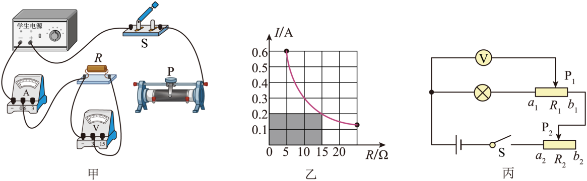

# Physics - 题目 1838

**ID**: abf3f756cf634c648e18a4efdd3c9dfd
**年级**: Grade 9
**难度**: Medium-Hard
**题型**: Experiment

## 题目
小华在“探究电流与电阻的关系”实验时，实验器材有：学生电源、电流表、电压表、滑动变阻器（20Ω 2A）、定值电阻4个（5Ω、10Ω、15Ω、20Ω）、开关一个、导线若干。​​​​​​​‌（1）请用笔画线代替导线将图甲中的实物图连接完整，要求：滑片P向右移动时电流表示数变小，导线不交叉；（2）连接好电路闭合开关前，滑动变阻器的滑片P置于合适位置 。闭合开关S，发现电流表有示数，电压表无示数，电路出现的故障可能是；（3）排除故障后正确进行实验，根据实验数据得到I﹣R图像如图乙。图乙中阴影部分面积表示的物理量是，本实验中电源电压不得超过V；（4）实验之后，小华利用一个已知最大阻值为R_{0}的滑动变阻器R_{1}设计如图丙的电路，测量额定电压为U_{0}的灯泡正常发光时的电功率。实验步骤：①移动滑片P_{2}到b_{2}端，闭合开关S，移动滑片P_{1}到a_{1}端，调节滑片P_{2}使电压表的示数为U_{0}；②移动滑片P_{1}到b_{1}端，读出电压表的示数为U；③小灯泡的额定功率P_{额}=。若实验中，小明在“②移动滑片P_{1}到b_{1}端，读出电压表的示数为U”时，不小心将滑片P_{2}向右移动少许，其他操作正确，则小灯泡的额定功率P_{额}的测量值（选填“大于”“小于”或“等于”）真实值。

## 解答

1. （1）要求滑片P向右移动时电流表示数变小，根据欧姆定律，电源电压不变时，电流变小则电路总电阻变大，所以滑动变阻器接入电路的电阻应变大，因此应将滑动变阻器左下接线柱接入电路。作图如下：
2. 
3. （2）闭合开关S，电流表有示数，说明电路是通路；电压表无示数，可能是与电压表并联的定值电阻短路，此时电压表被短路，所以无示数。
4. （3）图乙中阴影部分是电流I与电阻R的乘积，根据U=IR，可知阴影部分面积表示的物理量是定值电阻两端的电压；探究电流与电阻的关系时，要控制定值电阻两端电压不变。从图乙可知，当定值电阻的阻值为15Ω时，对应的电流为0.2A，则定值电阻两端电压 $U{{}_{{\rm{V}}}}=IR=0.2{\rm{A}}\times 15Ω=3{\rm{V}}$ ；当接入最大定值电阻20Ω时，将滑动变阻器阻值调到最大 $20Ω$ ，根据串联电路分压原理则有 $\frac {20Ω}{20Ω}=\frac {3{\rm{V}}}{U-3{\rm{V}}}$ ，解得电源电压 $U=6{\rm{V}}$ ，则本实验中电源电压不得超过6V。
5. （4）①移动滑片P_{2}到b_{2}端，闭合开关S，移动滑片P_{1}到a_{1}端，此时灯泡、 $R{{}_{1}}$ 的最大阻值 $R{{}_{0}}$ 和变阻器 $R{{}_{2}}$ 串联，电压表测灯泡电压，调节滑片P_{2}使电压表的示数为U_{0}，则灯泡正常发光；②移动滑片P_{1}到b_{1}端，此时连接方式不变，电压表改测灯泡和 $R{{}_{0}}$ 的总电压，读出电压表的示数为U，根据串联分压规律， $R{{}_{0}}$ 的电压为 $U-U{{}_{0}}$ ；③此时电路中电流等于灯泡的额定电流，则灯泡的额定电流 $I{{}_{额}}=\frac {U-U{{}_{0}}}{R{{}_{0}}}$ ，则小灯泡的额定功率为 $P{{}_{额}}=U{{}_{0}}I{{}_{额}}=U{{}_{0}}\frac {U-U{{}_{0}}}{R{{}_{0}}}$ ，小明在“②移动滑片P_{1}到b_{1}端，读出电压表的示数为U”时，不小心将滑片P_{2}向右移动少许， $R{{}_{2}}$ 接入电路的电阻变大。由串联电路分压原理可知， $R{{}_{2}}$ 两端电压变大，那么灯泡与 $R{{}_{1}}$ 两端的总电压 $U$ 变小。从 $P{{}_{额}}=U{{}_{0}}\frac {U-U{{}_{0}}}{R{{}_{0}}}$ 可看出，这样会导致结果变小。

## 知识点

**中文**:
  - 其他方法测量小灯泡的电功率
  - 电流与电阻关系的探究实验

**English**:
  - Other Methods for Measuring Bulb Power
  - Experiment: Relationship between Current and Resistance

---
