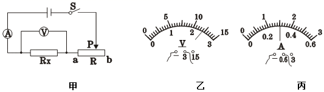

# Physics - 题目 707

**ID**: ae4a337dee374a8f9d1bf6a3469f084a
**年级**: Grade 9
**难度**: Medium-Hard
**题型**: Experiment

## 题目
小聪同学用伏安法测电阻，实验电路图如图甲所示．（1）该实验的原理是．（2）闭合开关S前，滑动变阻器滑片P应置于端（选填“a”或“b”）．（3）假如小聪同学用完好的器材按如图甲所示实验电路图正确连接电路，实验时正确操作，刚一“试触”，就发现电流表的指针迅速摆动到最大刻度，其原因可能是：①；​​​​​​​‌②．（4）小聪同学重新按图甲所示的实验电路图正确连接电路，进行实验，某次实验中电压表示数如图乙所示，电流表示数如图丙所示，被测电阻R_{x}=Ω．（5）若滑动变阻器的最大阻值为R，被测电阻的阻值为R_{x}，实验过程中电流表突然烧坏，不能正常使用了，他想出一个方法，应用现有的器材，也能测出电阻R_{x}的阻值．实验步骤如下：①将滑动变阻器滑到a端，闭合开关S，读出电压表的读数，记为U；②；③读出滑动变阻器的最大值R；④则被测电阻R_{x}的阻值为：R_{x}=（写出表达式）．

## 解答

1. （1）测量电阻的原理是欧姆定律的变形公式R= $\frac {U}{I}$ ；
2. （2）由图可知，滑动变阻器的下面接了左边的接线柱，为保护电路，闭合开关前，应将滑片移至右边，即b端，使其阻值最大；
3. （3）操作正确，刚一“试触”，就发现电流表的指针迅速摆动到最大刻度，说明电路中的电流较大，可能是电源电压过大或电流表的量程选择偏小；
4. （4）由图乙可知，电压表的量程为0～3V，分度值为0.1V，示数为2.4V；由图丙可知，电流表的量程为0～0.6A，分度值为0.02A，示数为0.3A；则R= $\frac {U}{I}=\frac {2.4{\rm{V}}}{0.3{\rm{A}}}$ =8Ω；
5. （5）被测电阻与滑动变阻器串联，电压表与被测电阻并联，开关串联在电路中，如图所示：
6. 
7. 将滑动变阻器滑到a端，闭合开关S，读出电压表的读数，记为U；
8. 将滑片移至b端，闭合开关S，读出此时电压表的示数为U_{1}，则滑动变阻器两端的电压为U-U_{1}；则电路中的电流I_{x}=I= $\frac {U-U{{}_{1}}}{R}$ ；则R_{x}= $\frac {U{{}_{{\rm{1}}}}}{\frac {U-U{{}_{{\rm{1}}}}}{R}}=\frac {U{{}_{{\rm{1}}}}R}{U-U{{}_{{\rm{1}}}}}$ ．

## 知识点

**中文**:
  - 伏安法测电阻的探究实验
  - 其他方法测电阻

**English**:
  - Experiment: Measuring Resistance (Voltammetry)
  - Other Methods for Measuring Resistance

---
