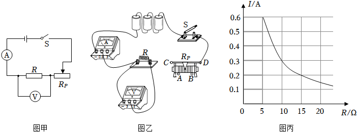

# Physics - 题目 512

**ID**: b9b2a022a10e42f9be1b13e083d7d8b1
**年级**: Grade 9
**难度**: Medium-Hard
**题型**: Experiment

## 题目
探究“电流与电阻的关系”时，可供实验器材有：三节新的干电池（电压为4.5V）、电流表、电压表、滑动变阻器（标有“20Ω 2A”字样）、定值电阻5个（5Ω、10Ω、15Ω、20Ω、50Ω），开关一个，导线若干。​​​​​​​‌小静等同学设计了如图甲所示的电路图：（1）请用笔画线代替导线将图乙中的实物图连接完整，要求：滑片向右移动时电阻变大；（2）闭合开关，电流表无示数，电压表有示数，并接近电源电压，则故障原因是：；（3）排除故障后，将定值电阻由5Ω更换为10Ω时，应向（选填“左”或“右”）适当调节滑动变阻器的滑片，使电压表示数保持不变；（4）图丙是根据实验数据画出的定值电阻的I-R图像，其中阴影部分面积表示的物理量是，其数值为；（5）实验中，在接入50Ω的定值电阻后，小静同学无论怎样移动滑片，都不能使电压表示数达到原来的数值，为了能完成这次实验，小静采取的措施可行的是；

## 解答

1. （1）[1]滑动变阻器接一个上接线柱和一个下接线柱串联在电路中，滑动变阻器滑片向右移动时电阻变大，所以滑动变阻器要接左下接线柱，如图所示：
2. 
3. （2）[2]若电流表没有示数，说明电路可能断路；电压表有示数，说明电压表、电流表、滑动变阻器、开关与电源相连，所以故障为与电压表并联的定值电阻断路。
4. （3）[3]根据串联分压原理可知，将定值电阻由5Ω改接成10Ω的电阻，电阻增大，其分得的电压增大；探究电流与电阻的实验中应控制电压不变，应保持电阻两端的电压不变，根据串联电路电压的规律可知应增大滑动变阻器两端的电压，由分压原理，应增大滑动变阻器连入电路中的电阻，所以滑片应向右端移动，使电压表示数恢复到原来的值。
5. （4）[4][5]根据画出I-R图像（如图乙）知，图中阴影面积为长方形，其面积等于IR，由欧姆定律得，U=IR，阴影面积表示的物理量是电阻两端的电压，其数值为
6. U_{电}=IR=0.6A×5Ω=3V
7. （5）[6]A．设电源电压为U，定值电阻两端的电压为U_{V}，当接入50Ω的定值电阻时，则
8. $\frac {U{\rm{-}}U{{}_{{\rm{V}}}}}{R{{}_{滑}}}{\rm{=}}\frac {U{{}_{{\rm{V}}}}}{R}$
9. 代入数据得
10. $\frac {U{\rm{-}}3{\rm{V}}}{20\Omega }{\rm{=}}\frac {3{\rm{V}}}{50\Omega }$
11. 解得电源电压为
12. U=4.2V
13. 所以降低电源电压可以完成这次实验，故A不符合题意；
14. BC．为了能完成这次实验，滑动变阻器的最小电阻为
15. $\frac {U^{′}{\rm{-}}U{{}_{{\rm{V}}}}}{R{{}_{滑}}}{\rm{=}}\frac {U{{}_{{\rm{V}}}}}{R}$
16. 代入数据得
17. $\frac {4.5{\rm{-}}3{\rm{V}}}{R{{}_{滑最大}}}{\rm{=}}\frac {3{\rm{V}}}{50\Omega }$
18. 解得滑动变阻器的最大电阻为R_{滑最大}=25Ω，所以更换一个最大阻值为30Ω的滑动变阻器可以完成这次实验，故B符合题意；
19. 再串联一个10Ω的电阻，测滑动变阻器与串联的电阻的总阻值为
20. ${\rm{2}}{\rm{0}}{\rm{Ω}}{\rm{+}}{\rm{1}}{\rm{0}}{\rm{Ω}}{\rm{=}}{\rm{3}}{\rm{0}}{\rm{Ω}}{\rm{>}}{\rm{2}}{\rm{5}}{\rm{Ω}}$
21. 故C符合题意；
22. D．将电压表改接到滑动变阻器两端，不能改变电阻的分压作用，无论怎样移动滑片，都不能使电压表示数达到原来的数值，所以不能完成这次实验，故D不符合题意。
23. 故选BC。
24. （6）[7]A．因电压表示数不变，即电流与R乘积为一定值，故电流随R的变化关系为反比例函数，故A不符合题意；
25. B．换用不同的电阻时，电压表示数不变，故B不符合题意；
26. C．定值电阻的电压为2V，变阻器的电压为1V，由分压原理，变阻器与R的比值为1∶2，故变阻器连入电路的电阻与R的关系为一过原点的直线，故C符合题意；
27. D．根据
28. $P{\rm{=}}UI{\rm{=}}\frac {U{^{2}}}{R}$
29. 定值电阻的功率为
30. $P{{}_{{\rm{R}}}}{\rm{=}}\frac {U{^{2}}}{R}{\rm{=}}\frac {(3{\rm{V}}){^{2}}}{R}$
31. 即电阻的电功率与R乘积为一定值，电阻的电功率随R变化关系为反比例函数，故D不符合题意。
32. 故选C。

## 知识点

**中文**:
  - 串、并联电路中短路和断路的分析
  - 连接电路实物图
  - 串联电路的电压规律
  - 电流与电阻关系的探究实验

**English**:
  - Analysis of Short and Open Circuits
  - Connecting Physical Circuits
  - Voltage Law in Series Circuits
  - Experiment: Relationship between Current and Resistance

---
