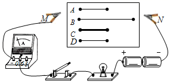

# Physics - 题目 588

**ID**: ba0568ef7b6445668703be841c89caa7
**年级**: Grade 9
**难度**: Medium-Hard
**题型**: Experiment

## 题目
在探究影响导体电阻大小的因素时，小兵、小红两位同学作出了如下猜想：①导体的电阻与导体的长度有关②导体的电阻与导体的横截面积有关。​​​​​​​‌③导体的电阻与导体的材料有关。实验室提供了4根电阻丝，规格、材料如下表编号材料长度/m横截面积/mm^{2}A镍铬合金0.50.5B镍铬合金1.00.5C镍铬合金0.51.0D锰铜合金0.50.5（1）如图所示的电路中，连接电路时开关应（“闭合”或“断开”），连接好电路后，在M、N之间分别接上不同的电阻丝；（2）分别将A和D两电阻丝接入如图电路中M、N两点间，电流表示数不相同，由此初步得到的结论是：导体电阻跟有关；（3）为了验证上述猜想①，应该选用编号为两根电阻丝进行实验；如果选用编号为A、C两根电阻丝进行实验，是为了验证猜想（填序号）；（4）有同学认为，可以根据灯泡亮度的变化来判断接入的电阻丝阻值的变化情况。老师指出：此实验中这种方法不可取。这是因为电源电压一定时，所选电阻丝的阻值相差太小，灯泡亮度变化（选填“明显”或“不明显”）；（5）在最近几年，我国城乡许多地区进行了输电线路的改造，将原来细的铝质输电线换成较粗的铝质输电线，这样就了输电线的电阻（选填“增大”或“减小”），从而可以减输电线上的电能损失。

## 解答

1. （1）[1]连接电路时，开关应处于断开状态。
2. （2）[2]分别将A和D两电阻丝接入电路中M、N两点间时，电流表示数不相同，则得到的结论是：长度和横截面积相同时，导体的材料不同，电阻不同。
3. （3）[3]要验证猜想①：导体的电阻与导体的长度有关，应控制导体的材料与横截面积相同，而长度不同，由表中数据可知，应选编号为A、B的两根电阻丝进行实验。
4. [4]由表中数据可知，A、C两电阻丝的长度、材料相同而横截面积不同，将A和C两电阻丝接入电路中M、N两点间，可验证导体电阻跟横截面积的关系，即猜想②。
5. （4）[5]此实验中这种方法不可取；这是因为电源电压一定时，所选电阻丝的阻值相差太小，两次电流相差较小，灯泡亮度变化不明显。
6. （5）[6]最近几年，我国城乡许多地区进行了输电线路的改造，将原来细的铝质输电线换成较粗的铝质输电线，即此时的材料、长度相同，横截面积变大，故其阻值变小，这样可以减小输电线上电能的损失。

## 知识点

**中文**:
  - 影响导体电阻大小因素的探究实验

**English**:
  - Experiment: Factors Affecting Resistance

---
