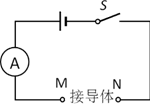

# Physics - 题目 1192

**ID**: bbf640df0d3348fd82e54f80b67dd396
**年级**: Grade 9
**难度**: Medium-Hard
**题型**: Experiment

## 题目
为了探究通过导体的电流与它两端的电压的关系，小明和小嘉两位同学用如图所示的电路，分别将材料相同，长度l、横截面积S不同的导体甲、乙、丙接入电路的M、N两端进行研究。​​​​​​​‌(1)在设计电路时，小明认为还需在M、N两端并联一个电压表才能正确测出导体两端的电压；小嘉认为干电池的电压是已知的，所以实验中不需要电压表。你认为（选填“小明”或“小嘉”）的观点是正确的；(2)经讨论后他们达成了共识，并将实验测得的数据记录在表一、表二和表三中；表一导体甲（l_{甲}=1米、S_{甲}=0.2毫米^{2}）实验序号电压（伏）电流（安）11.20.2422.40.4833.60.72表二导体乙（l_{乙}=1米、S_{乙}=0.1毫米^{2}）实验序号电压（伏）电流（安）41.20.1252.40.2463.60.36表三导体丙（l_{丙}=0.75米、S_{丙}=0.05毫米^{2}）实验序号电压（伏）电流（安）71.20.0882.40.1693.60.24①分析比较实验序号实验中的数据可得出的初步结论是：电压相同，通过不同导体的电流不同；②小嘉同学分析比较实验序号1、2、3（或4、5、6或7、8、9）实验中的电流、电压数据后认为：同一导体，通过它的电流越大，它两端的电压就越大，且电压与电流成正比；这个说法是否正确？理由是；③小明和小嘉又仔细研究了表一、表二和表三中的数据发现：导体两端的电压与通过导体的电流的比值是一个定值，它与导体的有关。

## 解答

1. (1)[1]虽然干电池的电压是已知的，但电流表和导线会分担一部分电压，从而导致M、N两端电压小于电源电压，故小明的观点是正确的，只有通过电压表的测量才能正确测出导体两端的电压。
2. (2)①[2]从不同导体的实验数据中，寻找电压相等的量，发现通过的电流不同，因此，符合这一结论的数据为1、4、7（或2、5、8或3、6、9）。
3. ②[3][4]分析比较实验序号1、2、3（或4、5、6或7、8、9）的实验，可以得出：电阻保持不变，导体两端的电压越大，通过导体的电流越大，即在电阻一定时，通过导体的电流与导体两端的电压成正比；而小嘉同学得出的结论是不正确的，因为电压是使自由电荷发生定向移动形成电流的原因，不能说电压与电流成正比，应该说同一导体，它两端电压越大，通过它的电流就越大，且电流与电压成正比。
4. ③[5]通过比较表一和表二的数据可以发现：同一导体，电压与电流的比值是一个定值，不同导体，这个比值不相等；表一和表二选用导体的材料一样，长度一样，但横截面积不一样，说明导体两端的电压与通过导体的电流的比值与导体的横截面积有关。

## 知识点

**中文**:
  - 电流与电压关系的探究实验

**English**:
  - Experiment: Relationship between Current and Voltage

---
