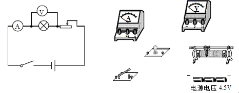
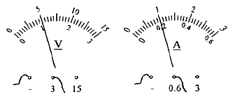

# Physics - 题目 599

**ID**: bc3b351d28e24a2e81adc41d98d57f7e
**年级**: Grade 9
**难度**: Medium-Hard
**题型**: Experiment

## 题目
（1）小霞按图连接实物、接通电路，电流表有示数，电压表示数为0.5V，当移动滑动变阻器滑片时，电压表示数不变，检查发现只有滑动变阻器接线出错，该错误是。​​​​​​​‌（2）按图的电路图在图中正确连接实物（3）正确连接后，小灯泡刚发光时电压表、电流表的示数如图所示，完成下表（）小灯泡的实验数据及发光情况发光情况刚发光较亮很亮U/V2.003.00I/A0.300.38R/Ω6.677.89（4）根据表，归纳小灯泡电阻变化的规律

## 解答

1. (1)当移动滑动变阻器滑片时，电压表示数不变，检查发现只有滑动变阻器接线出错，由于电压表示数只有0.5V，而电源电压为4.5V，所以该错误是：将滑动变阻器的下面两个接线柱连入了电路
2. (2)由图知，两表均选用小量程，滑动变阻器滑片左边部分连入电路，对照电路图连接实物图，如图所示；
3. 
4. (3)两电表均选用小量程，电压表的分度值为0.1V，示数为1.00V；电流表的分度值为0.02A，示数为0.20A，小灯泡的电阻：
5. $R=\frac {U}{I}{\rm{=}}\frac {{\rm{1}}{\rm{V}}}{{\rm{0}}{\rm{.}}{\rm{2}}{\rm{A}}}{\rm{=}}{\rm{5}}{\rm{Ω}}$
6. 则填表如下：
7. 发光情况
8. 刚发光
9. 较亮
10. 很亮
11. U/V
12. 1.00
13. 2.00
14. 3.00
15. I/A
16. 0.20
17. 0.30
18. 0.38
19. R/Ω
20. 5.00
21. 6.67
22. 7.89
23. (4)由表格数据可知灯泡两端的电压越高，灯越亮，温度越高，灯泡的电阻越大，即小灯泡的电阻随温度的升高而增大。

## 知识点

**中文**:
  - 导体的电阻受温度的影响

**English**:
  - Effect of Temperature on Resistance

---
