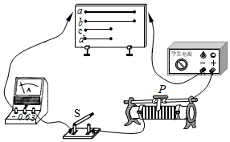

# Physics - 题目 1665

**ID**: bdb08ce587434813bd100037abf68d72
**年级**: Grade 9
**难度**: Medium-Hard
**题型**: Experiment

## 题目
某实验小组在“探究影响电阻大小的因素”时，选出符合要求的学生电源、滑动变阻器、电流表、开关、导线若干以及几种电阻丝，电阻丝的参数如表。​​​​​​​‌编号材料长度/m横截面积/mm^{2}a镍铬合金丝1.00.2b镍铬合金丝1.00.1c镍铬合金丝0.50.1d锰铜合金丝0.50.1小组成员做出了如下猜想：猜想1：电阻大小与导体的长度有关；猜想2：电阻大小与导体的材料有关；猜想3：电阻大小与导体的横截面积有关；设计了如图所示电路，请回答下列问题：①实验通过比较的大小，来比较电阻丝电阻的大小；②若要验证猜想1，则应该选用两根电阻丝（填编号）进行对比实验；③选用c、d两根电阻丝进行对比实验，目的是为了验证猜想；④实验中如果将电流表更换成小灯泡，通过观察也可以判断导体电阻的大小，但不足之处是。

## 解答

1. ①[1]实验中采用了转换法比较电阻大小，即通过比较电流表示数来比较导体电阻的大小。
2. ②[2]若要验证猜想1导体的电阻与导体的长度有关时，应控制导体的材料和横截面积不变，改变导体的长度，则编号b、c的电阻丝符合。
3. ③[3]选用c、d两根电阻丝可知，两者的横截面积和长度相同、材料不同，是验证导体的电阻与导体的材料是否有关，即验证了猜想2。
4. ④[4] [5]实验中可通过观察灯泡亮度来判断电阻的大小，但是当电路中电阻变化不大时，灯泡亮度变化不明显，只凭灯泡的亮暗不易区分。

## 知识点

**中文**:
  - 影响导体电阻大小因素的探究实验

**English**:
  - Experiment: Factors Affecting Resistance

---
