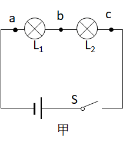
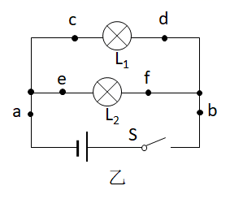

# Physics - 题目 957

**ID**: c2dec9605e294180b2b87645dd106e5e
**年级**: Grade 9
**难度**: Medium-Hard
**题型**: Experiment

## 题目
在“探究串、并联电路电压的规律”的实验中，张强同学分别按图甲、乙两电路图连接电路并进行实验，他将测量的数据分别记录在表一和表二中。​​​​​​​‌表一测量处accbbc电压（V）2.51.21.3表二测量处abcdef电压（V）2.52.52.5(1)表二数据是根据图（填“甲”或“乙”）电路进行实验得到的数据；(2)分析表一数据得到的结论是；分析表二数据得到的结论是；(3)这个实验在设计方案上还存在的不足之处是：，改进方法：。

## 解答

1. (1)[1]由表二数据可知三个测量位置的电压相等，可知是根据图乙的并联电路进行实验得到的数据。
2. (2)[2][3]分析表一数据，ac处的电压等于cb处的电压与bc处的电压之和，即串联电路两端总电压等于各部分电路两端电压之和；分析表二数据可知，在并联电路中各支路用电器两端的电压相等，且等于总电压。
3. (3)[4][5]这个实验在设计方案上还存在的不足之处是只做了一次实验，而没有进行多次测量，只凭一组实验数据得出结论带有偶然性，可以更换不同规格的灯泡多次测量。

## 知识点

**中文**:
  - 探究串、并联电路中的电压规律实验

**English**:
  - Experiment: Voltage Laws in Series/Parallel

---
