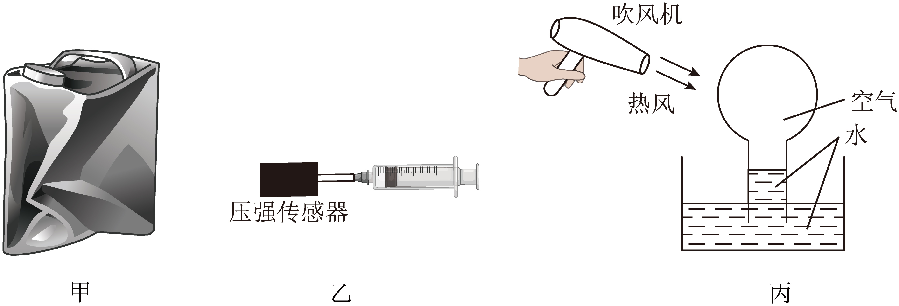

# Physics - 题目 870

**ID**: c3712fceef1146edaa80bd12298cf13f
**年级**: Grade 9
**难度**: Medium-Hard
**题型**: Experiment

## 题目
如图甲所示，在铁桶内放少量的水，用火加热，水沸腾后把桶口堵住，然后浇上冷水，发现铁桶很快变扁了。​​​​​​​‌（1）铁桶变扁是因为桶内的气压变小，铁桶在的作用下被压扁。（2）关于气体的压强大小与哪些因素有关，探究小组进行了如下猜想：猜想一：气体压强的大小可能与气体质量的大小有关；猜想二：气体压强的大小可能与气体温度高低有关；猜想三：气体压强的大小可能与气体体积的大小有关。（3）为探究猜想一和猜想三，探究小组同学设计了如图乙的实验：注射器内先密封着8mL的气体（质量约10.32mg），然后缓慢匀速推动活塞，改变气体的体积，并通过与注射头处连接的压强传感器读出相应的压强记录在表格中，然后给注射器内密封4mL的气体（质量约5.16mg），再进行实验，得到数据如表一所示：表一实验次数气体的质量m/mg气体的体积V/mL气体压强p/×10^{5}Pa110.3281.01210.3261.35310.3242.02410.3224.0455.1641.0165.1620.0275.1614.04①实验中“缓慢”匀速推动活塞的目的是控制注射器内空气的不变。②要探究气体压强与质量的关系，应该分析两次实验数据。③通过分析1、2、3、4实验数据可得：一定的空气，其压强与空气的体（选填“有关”或“无关”）。（4）为了探究气体压强与温度的关系，实验小组给一个烧瓶中封入一定质量的空气，然后分将温度传感器和压强传感器伸入烧瓶内并与计算机相连，再把烧瓶放入水中加热，适时记录温度相应的压强值，得到的实验数据如表二所示：表二温度t/℃20406080气体压强p/×10^{5}Pa1.011.081.151.22由表格数据可得：对一定质量的空气，体积不变时，压强变化量与温度变化量成。（5）如图丙所示，当用吹风机对着倒扣在水中的圆底烧瓶吹热风时，瓶内液面将（选填“上升”“下降”或“不变”）。

## 解答

1. （1）铁桶变扁是因为桶内的气压变小，铁桶在大气压的作用下被压扁。当铁桶内的水沸腾后把桶口堵住，再浇上冷水，桶内水蒸气遇冷液化，桶内气体压强减少，小于外界大气压，从而在大气压的作用下铁桶被压扁。
2. （3）①实验中“缓慢”匀速推动活塞的目的是控制注射器内空气的温度不变。因为快速推动活塞会使气体压缩或膨胀过快，外界对气体做功或气体对外界做功，气体内能会发生变化，从而导致温度变化，而缓慢推动活塞可以使气体有足够时间与外界进行热交换，保持温度不变。
3. ②要探究气体压强与质量的关系，应该分析3、5两次实验数据。因为这两次实验中气体的体积都是4mL，只有质量不同，符合控制变量法探究压强与质量关系的要求。
4. ③通过分析 1、2、3、4 实验数据可得：质量一定的空气，其压强与空气的体积有关。从数据可以看出，当气体质量一定时，随着体积的减小，压强逐渐增大。
5. （4）由表格数据可知，温度每增加20℃，气压压强增加0.07×10^{5}Pa，可得：对一定质量的空气，体积不变时，压强变化量与温度变化量成正比。
6. （5）当用吹风机对着倒扣在水中的圆底烧瓶吹热风时，瓶内液面将下降。因为烧瓶内空气温度升高，压强增大，大于外界大气压，会将水压出烧瓶，所以瓶内液面下降。

## 知识点

**中文**:
  - 大气压强的测量及标准大气压
  - 大气压的应用

**English**:
  - Measurement of Atmospheric Pressure & Standard ATM
  - Applications of Atmospheric Pressure

---
