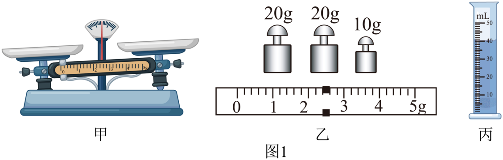
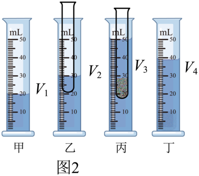

# Physics - 题目 1419

**ID**: c676c75d7f204113a92acf05e952c62f
**年级**: Grade 9
**难度**: Medium-Hard
**题型**: Experiment

## 题目
现在市场上出售的花盆，为了美观，盆土的表面上会覆盖一层白色的石英砂。​​​​​​​‌小明想测量这些石英砂的密度，做了如图实验。（1）将托盘天平放在水平桌面上，如图1甲所示，接下来的操作是：a、向调节平衡螺母，使天平平衡；b、在左盘放入适量的石英砂，在右盘加减砝码并移动游码使天平重新平衡，此时砝码的质量和游码的位置如图1乙所示，则石英砂的质量m=g；c、往量筒中倒入20mL水；d、把托盘天平的石英砂全部倒入量筒的水中，如图1丙所示：e、计算得石英砂的密度是kg/m^{3}；（2）测量完成后，小明想如果没有天平，能否测出石英砂的密度呢？他尝试了进行如下操作：a、把量筒中装入一定量的水，记为V_{1}，如图2甲；b、把空试管放入量筒中，稳定后，量筒内水面读数为V_{2}，如图2乙；c、在试管中装入一定量的石英砂，再把试管放入量筒中，稳定后，量筒内水面读数为V_{3}，如图2丙；d、把试管中的石英砂全部倒入量筒中，量筒内水面读数为V_{4}，如图2丁；根据以上操作写出石英砂密度的表达式；（用测量值与ρ_{水}表示），这样测得的石英砂的密度比真实值。

## 解答

1. （1）[1]将托盘天平放在水平面上，如图所示，横梁右端偏高，故向右调节平衡螺母。
2. [2]砝码的质量和游码的位置如图1乙所示，则石英砂的质量则为砝码的质量和标尺上读数之和，标尺的分度值为0.2g，标尺的读数为2.4g，因此石英砂的质量为
3. $m={\rm{2}}{\rm{0}}{\rm{g}}{\rm{+}}{\rm{2}}{\rm{0}}{\rm{g}}{\rm{+}}{\rm{5}}{\rm{g}}{\rm{+}}{\rm{2}}{\rm{.}}{\rm{4}}{\rm{g}}{\rm{=}}{\rm{4}}{\rm{7}}{\rm{.}}{\rm{4}}{\rm{g}}$
4. [3]如图1丙所示，水和石英砂的总体积为40mL，则石英砂的体积为
5. $V={\rm{4}}{\rm{0}}{\rm{m}}{\rm{L}}{\rm{-}}{\rm{2}}{\rm{0}}{\rm{m}}{\rm{L}}{\rm{=}}{\rm{2}}{\rm{0}}{\rm{m}}{\rm{L}}$
6. 则石英砂的密度为
7. $ρ=\frac {m}{V}=\frac {{\rm{4}}{\rm{7}}{\rm{.}}{\rm{4}}{\rm{g}}}{{\rm{2}}{\rm{0}}{\rm{c}}{\rm{m}}{^{{\rm{3}}}}}{\rm{=}}{\rm{2}}{\rm{.}}{\rm{3}}{\rm{7}}{\rm{g}}{\rm{/}}{\rm{c}}{\rm{m}}{^{{\rm{3}}}}{\rm{=}}{\rm{2}}{\rm{.}}{\rm{3}}{\rm{7}}{\rm{×}}{\rm{1}}{\rm{0}}{^{{\rm{3}}}}{\rm{k}}{\rm{g}}{\rm{/}}{\rm{m}}{^{{\rm{3}}}}$
8. （2）[4]根据题意，试管在水中浮力的变化量即为石英砂的重力，即石英砂的重力为
9. $G=ΔF{{}_{浮}}{\rm{=}}ρ{{}_{水}}gΔV{{}_{排}}=ρ{{}_{水}}g(V{{}_{3}}\mathrm{-}V{{}_{2}})$
10. 那么石英砂的质量为
11. $m=\frac {G}{g}=ρ{{}_{水}}(V{{}_{3}}\mathrm{-}V{{}_{2}})$
12. 由图2甲丁可得，石英砂的体积为
13. $V=V{{}_{4}}\mathrm{-}V{{}_{1}}$
14. 石英砂的密度为
15. $ρ=\frac {m}{V}=\frac {ρ{{}_{水}}(V{{}_{3}}\mathrm{-}V{{}_{2}})}{V{{}_{4}}\mathrm{-}V{{}_{1}}}$
16. [5]在测量体积时，拿走试管时 带走少部分水，这样测量的体积偏小，根据 $ρ=\frac {m}{V}$ ，这样测得石英砂的密度比真实值大。

## 知识点

**中文**:
  - 固体密度的测量实验

**English**:
  - Experiment: Measuring Density of Solids

---
