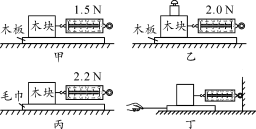

# Physics - 题目 2446

**ID**: c69ca1228c394cf0b1a13111a7ed38ea
**年级**: Grade 9
**难度**: Medium-Hard
**题型**: Experiment

## 题目
在探究“影响滑动摩擦力大小的因素”的实验中，小明用完全相同的木块分别做了如图所示的甲、乙、丙三个实验。​​​​​​​‌(1)将木块放在水平木板上，用弹簧测力计水平拉动木块，根据二力平衡知识可知，此时木块受到的滑动摩擦力大小等于弹簧测力计的示数。(2)甲、乙两个实验说明滑动摩擦力的大小与有关；两个实验说明了滑动摩擦力的大小与接触面粗糙程度有关。(3)小明认为滑动摩擦力的大小可能跟接触面的面积有关，于是他在上述实验的基础上，将木块沿竖直方向切成两部分继续进行实验，这种做法是正确的还是错误的？回答并说明理由：。(4)同学们在老师的指导下对实验装置进行改进，用如图丁所示的方式测量滑动摩擦力发现效果更好。图丁实验中（选填“一定”或“不一定”）要匀速拉动长木板。(5)在甲装置中，若木块所受拉力突然变大，木块做加速运动时，其所受摩擦力（选填“变大”“变小”或“不变”）。

## 解答

1. (1)[1]将木块放在水平木板上，用弹簧测力计沿水平方向匀速直线拉动木块，木块在水平方向上受到平衡力的作用，故木块受到的滑动摩擦力等于弹簧测力计的拉力，即木块受到的滑动摩擦力大小等于弹簧测力计的示数。
2. (2)[2][3]甲、乙两个实验，接触面粗糙程度相同，压力不同，弹簧测力计示数不同，说明滑动摩擦力的大小与压力有关；探究滑动摩擦力的大小与接触面粗糙程度的关系，要控制压力大小相同，接触面粗糙程度不同，甲、丙两个实验符合要求。
3. (3)[4]探究滑动摩擦力的大小跟接触面的面积的关系，要控制压力和接触面粗糙程度相同，将木块沿竖直方向切成两部分继续进行实验，压力大小改变了，故这种做法是错误的。
4. (4)[5]图丁中，木块处于静止状态，受到的摩擦力与弹簧测力计的拉力为一对平衡力，故用图丁的方式测量滑动摩擦力时不一定要匀速拉动长木板。
5. (5)[6]在甲装置中，木块在运动过程中所受拉力突然变大时，木块对接触面的压力和接触面的粗糙程度都不变，故所受滑动摩擦力不变。

## 知识点

**中文**:
  - 影响滑动摩擦力大小因素的探究实验

**English**:
  - Experiment: Factors Affecting Sliding Friction

---
