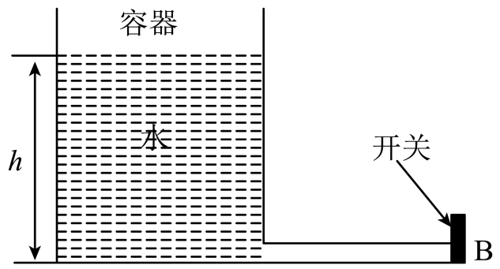

# Physics - 题目 149

**ID**: c9a27c3c24b4421381552b61c3957e13
**年级**: Grade 9
**难度**: Medium-Hard
**题型**: Experiment

## 题目
小婕同学发现储水容器在单位时间内的出水量不同。​​​​​​​‌她认为水管中单位时间的出水量可能跟水管两端液体的压强差Δp、横截面积S和长度L有关。为此，她设计了如图所示的装置进行研究，容器底部的水平管AB可以方便更换，B处的开关用于控制出水时间，并把相关实验数据记录在下表中。序号水管的截面积S水管的长度L/厘米容器内水的深度h/厘米单位时间出水量Q/毫升1202060230204034020304203090520401206202024072020540（1）打开开关后，容器中水的深度h大小可以反映水管AB两端的大小；为了使水管AB两端水的压强差尽量保持恒定，盛水容器的面积应该（选填“大”或“小”）；（2）分析比较实验序号1与6与7数据中Q与S变化的关系及相关条件，可初步得出的结论是；（3）根据实验序号数据中Q与h变化的关系及相关条件，可初步得出的结论是：在L和S相同的情况下，Δp越大，Q越大；（4）若h=20厘米、L=25厘米、S=S_{0}，则Q=毫升；若h=10厘米、L=60厘米、S=4S_{0}，则Q=毫升。

## 解答

1. （1）容器中水的深度h大小可以反映水管AB两端压强差的大小，这用到了转换法；盛水容器的面积越大，盛的水越多，水的高度变化越慢，水管AB两端的压强差变化越小，水管AB两端水的压强差保持恒定。
2. （2）分析比较实验序号1与6与7数据中Q与S变化，可发现水管的长度L与容器内水的深度h相同，随着水管的截面积S越来越大，单位时间出水量Q也变大，可得出初步结论是：在L与Δp相同的情况下，S越大，Q越大。
3. （3）要探究Q随h变化的关系并得到结论，我们需要控制水管的长度L与水管的截面积S相同，改变容器内水的深度h，可根据实验序号1与4与5分析得到。
4. （4）根据表中数据可知Q与h、S^{2}成正比、与L成反比，可以得到关系式 $Q=60\frac {hS{^{2}}}{LS{{}_{0}^{2}}}$ 。若h=20厘米、L=25厘米、S=S_{0}，代入关系式得48；若h=10厘米、L=60厘米、S=4S_{0}，代入关系式得160。

## 知识点

**中文**:
  - 液体压强的判断与计算
  - 液体压强的特点及应用

**English**:
  - Determination and Calculation of Liquid Pressure
  - Characteristics and Applications of Liquid Pressure

---
