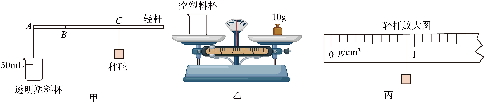

# Physics - 题目 469

**ID**: ca17cbf1373a4936b3a99a63d4392886
**年级**: Grade 9
**难度**: Medium-Hard
**题型**: Experiment

## 题目
如图甲所示，小明在青少年科技创新大赛中制作的杆秤密度计，它可以直接称量出液体的密度。​​​​​​​‌B为提挂点，B点的左侧端点A处悬挂透明塑料杯，右侧悬挂秤砣，不计硬质轻杆和细线的质量。其制作与测量过程如下：（1）距离轻杆左端点A处10cm的位置制作提挂点B；用天平称得空塑料杯质量如图乙所示，则空塑料杯质量为g；右侧秤砣用20g钩码拴上细线制成，将空塑料杯悬挂在A点，调节右侧秤砣细线位置，使轻杆在位置平衡，此时细线位置处标记为0g/m^{3}，此刻度线到提挂点B距离为cm；（2）将50mL水倒入塑料杯中，在液面处作标记，调节秤砣细线位置使轻杆再次平衡，并在此时秤砣细线位置处标记为“1”，此刻度线到提挂点B的距离为cm；将“0”到“1”刻度线之间均分10等份，则该密度计的分度值为${\rm{g}}{\rm{/}}{\rm{c}}{\rm{m}}{^{{{3}}}}$ ；按该分度值在轻杆上均匀画出其他刻度线，即制成了杆秤密度计；（3）用该密度计测量另一液体密度时，需将mL待测液体倒入空塑料杯中，秤砣细线位置如图丙所示，则该液体密度为${\rm{g}}{\rm{/}}{\rm{c}}{\rm{m}}{^{{{3}}}}$ ；（4）小华同学经过思考，认为用该密度秤还可以测算某些固体的密度。他将小石块（不吸水）放入空塑料杯中，杠杆平衡时，秤砣细线在“0.7”刻度线处，再向杯中加水至50mL标记处（石块已经浸没），轻杆再次平衡时，秤砣细线在“1.3”刻度线处，则小石块的密度为${\rm{g}}{\rm{/}}{\rm{c}}{\rm{m}}{^{{{3}}}}$ 。

## 解答

1. （1）如图乙所示，横梁标尺分度值为0.2g，游码对应刻度为零，则空塑料杯质量为 $m{{}_{0}}=10{\rm{g}}$ 。
2. 右侧秤砣用20g钩码拴上细线制成，将空塑料杯悬挂在A点，调节右侧秤砣细线位置，使轻杆在水平位置平衡，此时力臂和杠杆重合，便于测量力臂；根据杠杆平衡条件则有 $10{\rm{g}}\times 10{\rm{N}}/{\rm{k}}{\rm{g}}\times 10{\rm{c}}{\rm{m}}{\rm{=}}{{2}}{{0}}{\rm{g}}\times 10{\rm{N}}/{\rm{k}}{\rm{g}}\times l{{}_{0}}$
3. 解得零刻度线到提挂点B距离 $l{{}_{0}}=5{\rm{c}}{\rm{m}}$ 。
4. （2）50mL水质量为 $m{{}_{水}}=ρ{{}_{水}}V=1{\rm{g}}/{\rm{c}}{\rm{m}}{^{3}}\times 50{\rm{m}}{\rm{L}}=50{\rm{g}}$
5. 根据杠杆平衡条件则有 $m{{}_{水}}g\times l{{}_{物}}=m{{}_{秤砣}}g\times l{{}_{秤砣}}$
6. 则此刻度线到提挂点B的距离 $l{{}_{秤砣}}=\frac {\left ({m{{}_{水}}+m{{}_{杯}}}\right )m{{}_{水}}g\times l{{}_{物}}}{m{{}_{秤砣}}g}=\frac {\left ({50{\rm{g}}{{+}}{{1}}{{0}}{\rm{g}}}\right )\times 10{\rm{N}}/{\rm{k}}{\rm{g}}\times 10{\rm{c}}{\rm{m}}}{20{\rm{g}}\times 10{\rm{N}}/{\rm{k}}{\rm{g}}}=30{\rm{c}}{\rm{m}}$
7. 将“0”到“1”刻度线之间均分10等份，则该密度计的分度值为 $\frac {1{\rm{g}}/{\rm{c}}{\rm{m}}{^{3}}}{10}=0.1{\rm{g}}/{\rm{c}}{\rm{m}}{^{3}}$ 。
8. （3）每次测量时，应控制倒入到塑料杯的液体的体积相同，所以用该密度计测量另一液体密度时，需将 $50{\rm{m}}{\rm{L}}$ 待测液体倒入空塑料杯中，秤砣细线位置如图丙所示，在“0”后面第9格，则待测液体密度为 $ρ{{}_{液}}=9\times 0.1{\rm{g}}/{\rm{c}}{\rm{m}}{^{3}}=0.9{\rm{g}}/{\rm{c}}{\rm{m}}{^{3}}$
9. （4）将小石块（不吸水）放入空塑料杯中，杠杆平衡时，秤砣细线在“0.7”刻度线处，则石块的质量为 $m{{}_{石块}}=ρ{{}_{1}}V=0.7{\rm{g}}/{\rm{c}}{\rm{m}}{^{3}}\times 50{\rm{c}}{\rm{m}}{^{3}}=35{\rm{g}}$
10. 再向杯中加水至50mL标记处（石块已经浸没），轻杆再次平衡时，秤砣细线在“1.3”刻度线处，则塑料杯中小石块和水的总质量为 $m{{}_{总}}=ρ{{}_{2}}V=1.3{\rm{g}}/{\rm{c}}{\rm{m}}{^{3}}\times 50{\rm{c}}{\rm{m}}{^{3}}=65{\rm{g}}$
11. 则塑料杯中水的质量为 $m{{}_{水}}=m{{}_{总}}-m{{}_{石块}}=65{\rm{g}}-35{\rm{g}}=30{\rm{g}}$
12. 则塑料杯中水的体积为 $V{{}_{水}}=\frac {m{{}_{水}}}{ρ{{}_{水}}}=\frac {30{\rm{g}}}{1{\rm{g}}/{\rm{c}}{\rm{m}}{^{3}}}=30{\rm{c}}{\rm{m}}{^{3}}$
13. 则石块的体积为 $V{{}_{石块}}=V-V{{}_{水}}=50{\rm{c}}{\rm{m}}{^{3}}-30{\rm{c}}{\rm{m}}{^{3}}=20{\rm{c}}{\rm{m}}{^{3}}$
14. 则小石块的密度为 $ρ{{}_{石块}}=\frac {m{{}_{石块}}}{V{{}_{石块}}}=\frac {35{\rm{g}}}{20{\rm{c}}{\rm{m}}{^{3}}}=1.75{\rm{g}}/{\rm{c}}{\rm{m}}{^{3}}$

## 知识点

**中文**:
  - 特殊方法测密度
  - 跨学科实践

**English**:
  - Special Methods for Measuring Density
  - Interdisciplinary Practice

---
