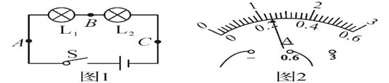

# Physics - 题目 1053

**ID**: ca2ec2e235ae4b87b2a5310b56daff2c
**年级**: Grade 9
**难度**: Medium-Hard
**题型**: Experiment

## 题目
探究“串并联电路中各点的电流关系”（1）小明在探究“串联电路中各点的电流关系”时，设计了如图1所示的实验，把灯泡L_{1}、L_{2}串联起来，分别把断开，把电流表接入，测量3个点流过的电流，在测量A点的电流时，刚接好最后一根线灯泡就亮了，但是发现电流表只偏转了一格，小明存在的错误是，电路需要调整的是。​​​​​​​‌（2）电路调整后，小明测得A点的电流如图2所示，用I_{A}表示，测通过A点的电流。（3）小明继续测出了B和C三点的电流分别为I_{B}和I_{C}，且示数分别为I_{B}=0.24A，I_{C}=0.24A．根据测量结果，初步得到串联电路电流的关系（写出关系式）。（4）小红接着探究并联电路电流的规律，她连接了如图3所示的实物图，此时，电流表测的是（“L_{1}”“L_{2}”或“干路”）的电流。（5）她测出了L_{1}、L_{2}支路和干路上的电流分别为I_{1}、I_{2}和I电流表的示数分别为I_{1}=0.2A，I_{2}=0.3A，I=0.5A．根据测量结果，初步得到并联电路中干路电流和支路电流的关系是（写出关系式）。

## 解答

1. （1）[1][2]刚接好最后一根导线，灯泡就亮了，说明连接电路时开关没有断开；电流表只偏转了一格，说明电流表的量程选大了，应改接小量程。
2. （2）[3]由图2可知，电流表使用0~0.6A量程，分度值为0.02A，示数为0.24A，即通过A点的电流是0.24A。
3. （3）[4]由实验数据知，通过A、B、C三点的电流相等，得到串联电路电流的关系
4. I_{A}=I_{B}=I
5. （4）[5]从实物图中可以看出，电流从电源正极流出，经过开关、电流表进行分支，分别经过两个灯泡回到电源负极，因此电流表测量的是干路电流。
6. （5）[6]由实验数据可得L_{1}、L_{2}支路和干路上的电流关系
7. 0.2A+0.3A=0.5A
8. 故可得并联电路中干路电流和支路电流的关系是
9. I=I1+I2

## 知识点

**中文**:
  - 探究串、并联电路的电流规律实验

**English**:
  - Experiment: Current Laws in Series/Parallel

---
