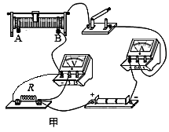
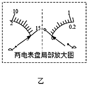
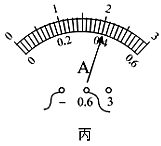
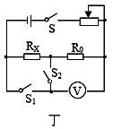

# Physics - 题目 2959

**ID**: cb2c1bbb47074fe1a4aae9b8f4920fe5
**年级**: Grade 9
**难度**: Medium-Hard
**题型**: Experiment

## 题目
小虎利用图甲的装置“探究电流和电阻、电压的关系”，其中的电源电压为4.5V，滑动变阻器的规格为“20Ω，1A”，选用的定值电阻的阻值分别是5Ω、10Ω、15Ω、20Ω。​​​​​​​‌(1)如图甲，闭合开关后，小虎无论怎样移动滑动变阻器的滑片，两电表的指针始终处于图乙所示的状态，则电路故障可能是；(2)小虎排除故障后，将5Ω的电阻接入电路，闭合开关，多次移动滑动变阻器的滑片，记录对应的几组电压表和电流表的示数，此过程小虎探究的是电流与的关系；(3)要完成预定的实验任务，小虎把5Ω的电阻接入电路后，闭合开关，适当调节滑片的位置，电流表的示数如图丙所示；①实验中，把5Ω的电阻换成10Ω的电阻后，需要调节滑动变阻器，使电压表示数为V；②为了完成4次实验，在实验开始前，可以分别采取的措施有。（填选项前的字母）

## 解答

1. (1)[1]如图甲，闭合开关后，小虎无论怎样移动滑动变阻器的滑片，两电表的指针始终处于图乙所示的状态，电流表示数为0，电路可能断路，电压表示数达到最大值，电压表与电源连通，则电路故障可能是R断路。
2. (2)[2]小虎排除故障后，将5Ω的电阻（控制电阻不变）接入电路，闭合开关，多次移动滑动变阻器的滑片，记录对应的几组电压表和电流表的示数，此过程小虎探究的是电流与电压的关系。
3. (3) ①[3]要完成预定的实验任务，小虎把5Ω的电阻接入电路后，闭合开关，适当调节滑片的位置，电流表的示数如图丙所示，电流表选用小量程，分度值为0.02A，电流为0.4A，
4. 由欧姆定律，电阻的电压为
5. $U{{}_{{\rm{V}}}}=IR=0.4{\rm{A}}\times 5{\rm{Ω}}=2{\rm{V}}$
6. 研究电流与电阻的关系，要控制电阻的电压不变，故实验中，把5Ω的电阻换成10Ω的电阻后，需要调节滑动变阻器，使电压表示数为2V。
7. ②[4]A．电阻两端的电压始终保持 $U{{}_{{\rm{V}}}}＝2{\rm{V}}$ ，根据串联电路电压的规律，变阻器分得的电压
8. $U{{}_{滑}}=U-U{{}_{{\rm{V}}}}=4.5{\rm{V}}-2{\rm{V}}=2.5{\rm{V}}$
9. 变阻器分得的电压为电压表示数的1.25倍，根据分压原理，当接入20Ω电阻时，变阻器连入电路中的电阻为
10. $R{{}_{滑}}=1.25\times 20{\rm{Ω}}=25{\rm{Ω}}$
11. 故为了完成整个实验，应该选取最大阻值至少25Ω的滑动变阻器，故A不符合题意；
12. BC．因题中变阻器的最大电阻为20Ω，由串联电阻的规律，在甲图中串联的定值电阻至少为
13. $R{{}_{串}}=25{\rm{Ω}}-20{\rm{Ω}}=5{\rm{Ω}}$
14. 当定值电阻最小为5Ω时，由分压原理，定值电阻之外的电阻为
15. $R{{}_{串}}{^{\prime }}=1.25\times 5{\rm{Ω}}=6.25{\rm{Ω}}$
16. 即串联的定值电阻最大为6.25Ω（此时变阻器连入电路的电阻为0），即串联的定值电阻范围为5Ω~6.25Ω，故B符合题意，C不符合题意；
17. D．因变阻器最大电阻太小，故变阻器最大电阻连入电路中时，定值电阻的电压也大于2V，故在不更换变阻器的条件下，要适当减小电源电压，故D符合题意。
18. 故选BD。
19. (4)[5][6]①闭合S、S_{1}，断开S_{2}，适当调节滑片的位置，电压表示数为U_{1}；②接着断开S_{1}，闭合S_{2}，滑动变阻器滑片的位置保持不变，电压表示数为U_{2}。在操作①中，电压表测待电阻和定值电阻的电压，在操作②中，电压表测定值电阻的电压，因电路的连接没有改变，各电阻的阻值和电压大小不变，由串联电路电压的规律，待测电阻的电压为
20. $U{{}_{{\rm{x}}}}=U{{}_{1}}-U{{}_{2}}$
21. 根据串联电路分压规律可得
22. $\frac {R{{}_{x}}}{U{{}_{1}}-U{{}_{2}}}=\frac {R{{}_{0}}}{U{{}_{2}}}$
23. 未知电阻的阻值
24. $R{{}_{{\rm{x}}}}=\frac {U{{}_{1}}-U{{}_{2}}}{U{{}_{2}}}R{{}_{0}}$

## 知识点

**中文**:
  - 其他方法测电阻
  - 电流与电压关系的探究实验
  - 电流与电阻关系的探究实验

**English**:
  - Other Methods for Measuring Resistance
  - Experiment: Relationship between Current and Voltage
  - Experiment: Relationship between Current and Resistance

---
