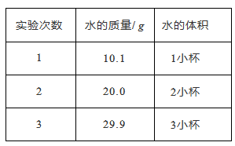
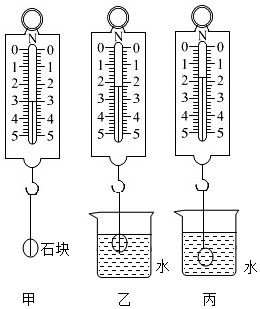

# Physics - 题目 2605

**ID**: cc989cdd00aa407e9a78b6a780e89f06
**年级**: Grade 9
**难度**: Medium-Hard
**题型**: Experiment

## 题目
（1）小丽发现∶体积大的铁块质量大；体积大的木块质量也大；水也是这样。​​​​​​​‌于是，她选用水来“探究同种物质的质量与体积的关系”。①小丽测量水的质量需要的器材有∶盛水的容器、水、烧杯和o②小丽为了简化实验，找来一个小杯，通过实验得到下列数据∶分析表中的实验数据，小丽可以得到的实验结论是∶水的质量与体积成比。③小梅用另一种杯子按小丽的方法“探究水的质量与体积的关系”，得出了与小丽完全相同的结论。在与小丽交流时，发现这种实验方法虽然简单，但由他们的实验数据得出的质量与体积的不一致。为解决这一问题，他们决定用量筒替代小杯继续进行。(2)小明用右图所示装置来验证“浸在液体中的物体受到浮力的作用”。①由图甲可知，小明选用的石块的重力是N。②如图乙、丙所示，挂在弹簧测力计挂钩上的石块浸入水中时，小明通过观察发现弹簧测力计示数（选填“变大”“变小”或“不变" ），则说明“浸在水中的石块受到了浮力的作用”。③小明要得出“浸在液体中的物体受到浮力的作用”的实验结论，他还要选用来继续做更多次的实验。

## 解答

1. (1)①[1]测量水的质量需要的器材是天平；
2. ②[2]分析数据可知水的质量与体积成正比；
3. ③[3]但由他们的实验数据得出的质量与体积的数量关系不一致；
4. (2)①[4]由图甲可知，小明选用的石块的重力是3N；
5. ②[5]挂在弹簧测力计挂钩上的石块浸入水中时，小明通过观察发现弹簧测力计示数变小，则说明“浸在水中的石块受到了浮力的作用”；
6. ③[6]小明要得出“浸在液体中的物体受到浮力的作用”的实验结论，他还要选用不同的物体和液体来继续做更多次的实验，这样实验结论才具有普遍规律。

## 知识点

**中文**:
  - 探究物质的质量与体积的关系

**English**:
  - Investigation: Relationship between Mass and Volume

---
