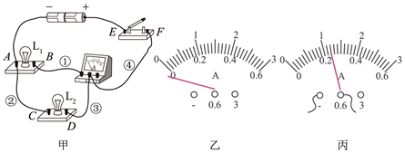
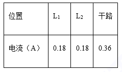

# Physics - 题目 2422

**ID**: cd43ba856baf4fe3875364c52f16ff5e
**年级**: Grade 9
**难度**: Medium-Hard
**题型**: Experiment

## 题目
在“探究并联电路电流规律”的实验中：（1）连接电路前，发现电流表指针位置如图乙所示，接下来应该进行的操作是；连接电路的过程中要用方法选择电流表的量程。​​​​​​​‌连接完电路闭合开关，发现电流表的指针又偏向图乙位置，其原因是。（2）图甲所示电路中电流表测的是灯（选填“L_{1}”或“L_{2}”）的电流。解决上述问题和故障后，闭合开关电流表的示数如图丙所示，则通过该处的电流是mA。（3）图甲中只需将导线（填导线的序号）接端，改接接线柱就可测得干路中电流。（4）某小组的同学实验时测出通过L_{1}、L_{2}和干路三处的电流值如下表，由此就得出结论：并联电路中，干路电流等于各支路电流之和，且各支路的电流相等。这个小组的同学在实验方案设计上存在的两点不足之处是和。

## 解答

1. （1）[1]连接电路前，发现如图乙，电流表指针偏转到了零刻度线的左侧，说明电流表指针没有调零，所以接下来的操作是将电流表的指针调零。
2. [2]连接电路的过程中，为了安全，电流表需要先用大量程试触，如果指针偏转角度小于电流表的小量程，再改用小量程。
3. [3]连接完电路闭合开关，发现电流表的指针又偏向图乙位置，说明电流从电流表的负接线柱流入，正接线柱流出，这是因为电流表的正负接线柱接反了。
4. （2）[4][5]如图，两灯并联，电流表串联在灯泡L_{1}所在的支路，故电流表测量通过灯泡L_{1}的电流；如图丙所示，电流表选择的是0~0.6A量程，电流表的分度值为0.02A，故读数为0.24A，合240mA。
5. （3）[6][7][8]电流表需要测量干路电流，故电流经过电流表后再分流，故将③接0.6A端改接为电流表的“-”接线柱即可。
6. （4）[9][10]从表格中数据可知，仅仅一次就得出结论不具有普遍性，且由于灯泡的规格相同，才得出各支路的电流相等的结论，不具有普遍性，故不足之处选用了规格相同的灯泡，实验次数太少，结论具有偶然性。

## 知识点

**中文**:
  - 探究串、并联电路的电流规律实验

**English**:
  - Experiment: Current Laws in Series/Parallel

---
