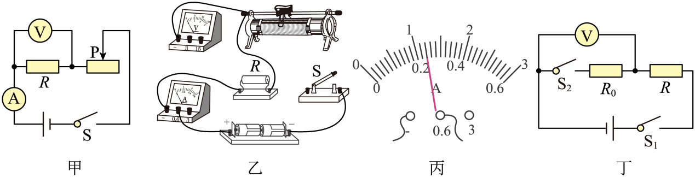

# Physics - 题目 654

**ID**: ce019f6d646f41668daccc965b1eac4a
**年级**: Grade 9
**难度**: Medium-Hard
**题型**: Experiment

## 题目
小明为了测量定值电阻R的阻值，设计了如图甲所示的电路。​​​​​​​‌（1）请用笔画线代替导线，将图乙中未完成的电路补充完整。（      ）（要求：变阻器滑片向右移动时电流表示数变大）。连接电路时，开关应处于状态；（2）连接好电路，闭合开关，发现电流表和电压表都有较大的示数，且无论怎样移动滑动变阻器的滑片，电流表和电压表的示数都不变。造成这一现象的原因可能是；

## 解答

1. （1）变阻器滑片向右移动时电流表示数变大，电阻丝长度变短，滑动变阻器的右下方接线柱与定值电阻串联，如下图所示：
2. 
3. 连接电路时，开关应处于断开状态。
4. （2）闭合开关，发现电流表和电压表都有较大的示数，说明电路为通路；且无论怎样移动滑动变阻器的滑片，电流表和电压表的示数都不变，说明滑动变阻器没有改变电路中的电阻，为短路，即滑动变阻器短路，故C正确。
5. （3）①由丙图可知，电流表的量程为0～0.6A，分度值为0.02A，示数为0.24A。
6. ②由 $I=\frac {U}{R}$ ​可得，定值电阻的阻值 $R=\frac {U}{I}=\frac {0.6{\rm{V}}}{0.3{\rm{A}}}=2{\rm{Ω}}$ ，而定值电阻的阻值为5Ω，故第1组数据错误的原因是：电流表读错了，误将量程按0～3A读了。由串联电路的分压特点可知，要使定值电阻两端的电压增大，应减小滑动变阻器接入电路中的电阻，即滑片向右移动（看实物电路）。
7. （4）分析图丁的电路可知：只闭合S_{1}时，电路为断路，电压表测量电源电压，示数为U_{1}，再闭合开关S_{2}，R_{0}与R串联，电压表测R_{0}两端的电压U_{2}；根据串联电路电流的规律
8. $I=I{{}_{0}}=\frac {U{{}_{2}}}{R{{}_{0}}}$ ，闭合开关S_{1}和S_{1}，R两端的电压_{R}=U_{1}−U_{2}，由欧姆定律，可得待测电阻R的阻值为 $R=\frac {U{{}_{{\rm{R}}}}}{I}=\frac {U{{}_{1}}-U{{}_{2}}}{\frac {U{{}_{2}}}{R{{}_{0}}}}=\frac {\left ({U{{}_{1}}-U{{}_{2}}}\right )R{{}_{0}}}{U{{}_{2}}}$ 。

## 知识点

**中文**:
  - 伏安法测电阻的探究实验
  - 其他方法测电阻

**English**:
  - Experiment: Measuring Resistance (Voltammetry)
  - Other Methods for Measuring Resistance

---
