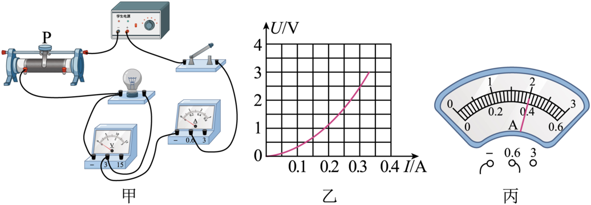

# Physics - 题目 249

**ID**: d2160c3763ae48109ba75afb26a332ca
**年级**: Grade 9
**难度**: Medium-Hard
**题型**: Experiment

## 题目
如图甲，是研究小灯泡电阻的实验装置，灯泡的额定电压为2.5V，滑动变阻器最大阻值是50Ω，电源电压保持6V不变。​​​​​​​‌（1）连接电路后，闭合开关，若小灯泡较暗，电流表有示数，电压表有示数，调节滑动变阻器的滑片，两表的示数都不变，原因是滑动变阻器接了两个接线柱。（2）正确连接后，闭合开关，移动滑片P，记下多组对应的电压表和电流表的示数。当滑片P移到某处，电压表示数为1.5V时，要使小灯泡正常发光，应（选填“增大”或“减小”）滑动变阻器接入电路中的阻值。（3） 将所测数据绘制成如图乙所示的U﹣I图像。由图可知：小灯泡的电阻是变化的，主要是因为小灯泡灯丝的（选填“温度”“长度”或“横截面积”）发生了变化；此小灯泡的额定功率是W。（4）利用此装置还可以探究电流与电阻的关系，只需将图甲中的小灯泡换成不同阻值的定值电阻，并使定值电阻两端的电压保持不变，即可进行实验。接入某定值电阻后，闭合开关，移动变阻器的滑片P，当电压表的示数为2V时，电流表的示数如图丙所示，为A，则接入的定值电阻的阻值为Ω。实验时，为了确保不同定值电阻两端的电压能达到并保持2V不变，换用的定值电阻阻值不能大于Ω。

## 解答

1. （1）[1]连好电路闭合开关后，发现小灯泡发光较暗，说明电路为通路，电流较小，电阻较大，无论如何移动滑动变阻器滑片P，小灯泡亮度都不变，说明变阻器没有变阻的作用，则原因可能是：将变阻器的下面两个接线柱连入了电路。
2. （2）[2]当电压表示数为 $1.5{\rm{V}}$ 时，电压表示数小于灯泡额定电压，要使灯泡正常发光，应向右端移动滑动变阻器滑片来减小滑动变阻器的电阻，从而增大灯泡两端的电压，直到电压表示数等于灯泡额定电压 $2.5{\rm{V}}$ 为止。
3. （3）[3]从图中 $U-I$ 图像可看出小灯泡灯丝两端的的电压和电流不成正比，即电阻随温度的变化而发生了变化。
4. [4]如图乙所示的 $U-I$ 图像知，灯的电压为 $2.5{\rm{V}}$ 时，电流大小为 $0.3{\rm{A}}$ ，小灯泡的额定功率
5. $P{{}_{{\rm{L}}}}=U{{}_{{\rm{L}}}}I{{}_{{\rm{L}}}}=2.5{\rm{V}}\times 0.3{\rm{A}}=0.75{\rm{W}}$
6. （4）[5][6]闭合开关，移动变阻器的滑片P，使定值电阻两端的电压为 $2{\rm{V}}$ ，此时电流表的示数如图丙，图中电流表选用小量程，分度值为 $0.02{\rm{A}}$ ，大小为为 $0.4{\rm{A}}$ ，由欧姆定律，则定值电阻的阻值
7. $R=\frac {U}{I}=\frac {2{\rm{V}}}{0.4{\rm{A}}}=5{\rm{Ω}}$
8. [7]探究电流与电阻的关系，应保持电阻两端的电压不变，即实验时控制定值电阻两端的电压保持 $2{\rm{V}}$ 不变，根据串联电路电压的规律，变阻器分得的电压为
9. $6{\rm{V}}-2{\rm{V}}=4{\rm{V}}$
10. 由分压原理，电阻的电压为变阻器电压的
11. $\frac {2{\rm{V}}}{4{\rm{V}}}=\frac {1}{2}$
12. 则更换的定值电阻的阻值不能大于
13. $\frac {1}{2}\times 50{\rm{Ω}}=25{\rm{Ω}}$

## 知识点

**中文**:
  - 导体的电阻受温度的影响
  - 电流与电阻关系的探究实验
  - 欧姆定律的应用
  - 电功率的计算及应用

**English**:
  - Effect of Temperature on Resistance
  - Experiment: Relationship between Current and Resistance
  - Applications of Ohm's Law
  - Calculation and Application of Electric Power

---
