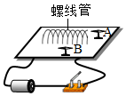

# Physics - 题目 2470

**ID**: d493ec0f449c4eac8c20b4069caea55c
**年级**: Grade 9
**难度**: Medium-Hard
**题型**: Experiment

## 题目
在“探究通电螺线管外部磁场的方向”实验中：(1)小磁针的作用：。​​​​​​​‌(2)在螺线管外部A、B两处放置小磁针，闭合开关，发现A处小磁针发生偏转，而B处小磁针不偏转，试说明B处小磁针不偏转的可能原因：(3)将电池的正负极对调，重复上述实验，是为了探究通电螺线管外部磁场的方向与方向的关系。(4)观察实验现象后，应立即断开开关，是为了。

## 解答

1. (1)[1]通电时螺线管周围存在磁场，小磁针在磁场中受到力的作用会发生偏转，所以小磁针能显示磁场的存在；当电流方向改变时，产生的磁场方向也改变，所以小磁针的偏转方向也改变，因此利用小磁针还可以判断磁场的方向。
2. (2)[2]在螺线管外部A、B两处放置小磁针，闭合开关，发现A处小磁针发生偏转，A处的小磁针会指示磁场的方向；B处小磁针不偏转，可能原因是小磁针N极的指向与磁场方向相同。
3. (3)[3]将电池的正负极对调，此时螺线管中电流的方向发生变化，磁场的方向发生变化，是为了探究通电螺线管外部磁场的方向与电流方向的关系。
4. (4)[4]螺线管是由导线绕成的，其电阻较小，根据欧姆定律可知，通过螺线管的电流较大，产生的热量较多，为了保护电路，观察实验现象后，应立即断开开关。

## 知识点

**中文**:
  - 通电螺线管的磁场

**English**:
  - Magnetic Field of Energized Solenoid

---
