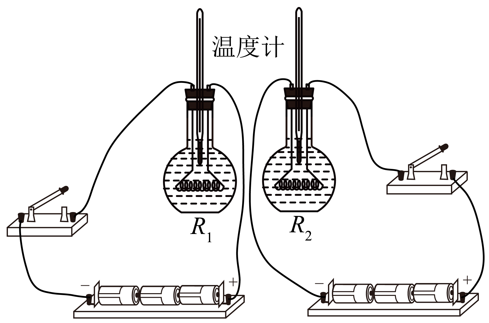
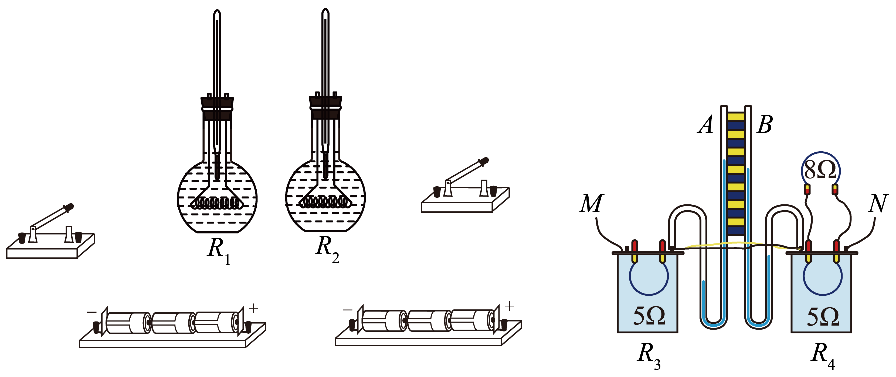

# Physics - 题目 635

**ID**: db30beb401df48c79fff113ce5316fd2
**年级**: Grade 9
**难度**: Medium-Hard
**题型**: Experiment

## 题目
在探究电流通过导体产生电热与电阻的实验中，小谢设计了图的电路进行实验，其中电阻R1＞R2。​​​​​​​‌（电源提供相同的电压）（1）小明认为图的电路不符合实验要求，流过两个电阻的电流大小不一定相等。“电流大小不相等”分析的依据是；（2）请在原来的器材选择合适的器材，在图中连接一个正确的探究电路；（3）小芳用两个透明容器中密封着等量的空气，玻璃管中液柱高度相同，两个容器中的电阻一样大，电路连接如图所示。MN分别接到电源两端，闭合开关后，观察A、B两管液柱升高的高度。此电路①能探究导体产生电热与通电时间、大小的关系。②8Ω电阻的作用是。（4）若图电路通电20s，测得流过R3的电流为0.2A，根据焦耳定律的公式，可知在R3产生的电热Q＝J。

## 解答

1. （1）[1]电源电压相同，根据I＝ $\frac {U}{R}$ 可知，当R不同时，通过两电阻的电流不相等。
2. （2）[2]为了控制通过R1、R2的电流相等，可以把R1、R2串联在同一个电源上，利用开关控制电路的通断，电路图如下：
3. 
4. （3）[3]①右侧两电阻并联，然后与左侧的电阻串联，透明容器内的电阻相同，根据串并联电路的电流特点可知，通过左侧容器内电阻的电流要大于通过右侧容器内电阻的电流，所以能探究导体产生电热与通电时间、电流大小的关系。
5. [4]②右侧容器外8Ω电阻处在一条支路上，根据并联电路中干路电路等于支路电流之和可知，它的作用是分流，使左右两容器内电阻通过的电流不相等。
6. （4）[5] [6]若图电路通电20s，测得流过R3的电流为0.2A，根据焦耳定律的公式
7. Q＝I2Rt
8. 可知，R3产生的电热
9. Q＝I32R3t＝(0.2A)2×5Ω×20s＝4J

## 知识点

**中文**:
  - 影响电流热效应因素的探究实验

**English**:
  - Experiment: Factors Affecting Heating Effect

---
