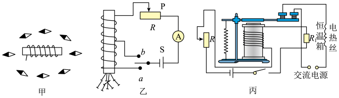

# Physics - 题目 1153

**ID**: e066acc1bf8f4c038a8ef22dda44c862
**年级**: Grade 9
**难度**: Medium-Hard
**题型**: Experiment

## 题目
完成下列关于电流磁效应的有关问题：（1）小明用如图所示的装置探究通电螺线管外部强场，选用小磁针是为了，改变通电螺线管中的电流方向，发现小磁针指向转动180°，由此可知，通电螺线饮外部的磁场方向与螺线管中方向有关。​​​​​​​‌（2）小红用图乙所示电路研究通电嫌线管的磁场。她先将开关S接a，观察电流表的示数及吸引图钉的数目；再将开关S从a换到b，调节变阻器的滑片P，再次观察电流表的示数及吸引图钉的数目，此时调节滑动变阻器是为了，来探究的关系。（3）如图丙所示为小华设计的恒温加热器电路，他使用电磁继电器实现自动控制，图中R_{1}应选用阻值随温度升高而的热敏电阻，为提高该恒温箱的工作温度，下列操作可行的是。

## 解答

1. （1）选用小磁针是为了显示磁场的方向，即小磁针静止时N极的指向为该点的磁场方向；改变通电螺线管中的电流方向，小磁针指向转动180°，说明通电螺线管外部的磁场方向与螺线管中电流方向有关。
2. （2）实验中，他将开关S从a换到b上时，连入电路的线圈匝数发生了变化，为了保证电流不变，应调节变阻器的滑片P，控制两次实验的电流大小不变，再次观察电流表示数及吸引的大头针数目，这样才能探究出通电螺线管磁性强弱与线圈匝数的关系。
3. （3）当加热器的温度到达设定值后应该使电热丝停止工作，即电磁铁吸引衔铁，此时电磁铁的磁性应增强，电路中的电流应变大，根据欧姆定律可知，电路中的总电阻变小，即热敏电阻的阻值变小，故R_{1}应选用阻值随温度升高而减小的热敏电阻。
4. 为提高该恒温箱的工作温度，应减小电磁铁的磁性；
5. A．将滑动变阻器R阻值取小一些，根据欧姆定律可知，此时电路中的电流变大，电磁铁磁性增强，故A不符合题意；
6. B．换用电压较大的直流电源U，根据欧姆定律可知，此时电路中的电流变大，电磁铁磁性增强，故B不符合题意；
7. C．换用相同长度时弹力更大的弹簧，在磁性相同的情况下，衔铁不容易被吸下，使得电热丝工作时间增长，温度升高，故C符合题意。
8. 故选C。

## 知识点

**中文**:
  - 影响电磁铁磁性强弱因素的探究实验
  - 通电螺线管的磁场
  - 电磁继电器的构造及原理

**English**:
  - Experiment: Factors Affecting Electromagnet Strength
  - Magnetic Field of Energized Solenoid
  - Structure and Principle of Electromagnetic Relays

---
