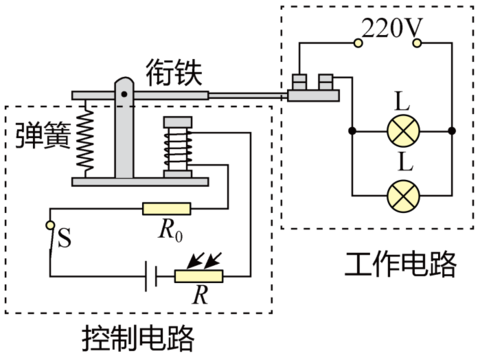

# Physics - 题目 1346

**ID**: e52fb7bacfe34a849f178411f53ed7e9
**年级**: Grade 9
**难度**: Medium-Hard
**题型**: Experiment

## 题目
小聪利用光敏电阻为社区设计了一种自动草坪灯，其工作原理如图所示。​​​​​​​‌工作电路中有两盏规格均为“220V   44W”的灯泡L，天暗时灯自动发光，天亮时灯自动熄灭。控制电路中电源电压U恒为6V，定值电阻R为200Ω。在一定范围内，光敏电阻R的阻值与光照强度E（光照强度E的单位为lx，光越强光照强度越大）之间存在一定关系，部分数据如下表所示。电磁铁的线圈电阻忽略不计，当天色渐暗，通过线圈的电流为0.02A时，恰好启动工作电路的照明系统。试问：光照强度E/lx1.02.03.04.05.0光敏电阻R/Ω12060403024（1）随着光照强度减小，光敏电阻R的阻值（选填“增大”或“减小”），电磁铁的磁性（选填“增强”或“减弱”），当光照强度减小到一定值时，衔铁会被（选填“吸下”或“释放”），照明系统启动。（2）两盏灯均正常发光时，工作电路中的总电流是多少？（3）照明系统恰好启动时，光敏电阻R的阻值为多少？此时光照强度为多少？

## 解答

1. （1）[1]由表格信息可知，关照强度由5.0lx减小到1.0lx时，光敏电阻的阻值从24Ω增大到120Ω，说明随着光照强度的减小，光敏电阻的阻值增大。
2. [2][3]影响电磁铁磁性的因素有：电流大小和线圈匝数。由题意可知，光敏电阻阻值变大时，电路中的电流变小，在线圈匝数不变时，磁性减弱。当光照强度减小到一定值时，衔铁会被释放，此时工作电路接通，照明系统启动。
3. （2）[4]由工作电路电路图可知，俩个同规格的灯泡并联在220V电压上，则电路中的总电流为
4. $I{{}_{总}}=\frac {P}{U}+\frac {P}{U}=\frac {{\rm{4}}{\rm{4}}{\rm{W}}}{{\rm{2}}{\rm{2}}{\rm{0}}{\rm{V}}}{\rm{+}}\frac {{\rm{4}}{\rm{4}}{\rm{W}}}{{\rm{2}}{\rm{2}}{\rm{0}}{\rm{V}}}{\rm{=}}{\rm{0}}{\rm{.}}{\rm{2}}{\rm{A}}{\rm{+}}{\rm{0}}{\rm{.}}{\rm{2}}{\rm{A}}{\rm{=}}{\rm{0}}{\rm{.}}{\rm{4}}{\rm{A}}$
5. （3）[5][6]照明系统恰好启动时，通过线圈的电流为0.02A，则此时控制电路的总电阻为
6. $R{{}_{总}}{\rm{=}}\frac {U{{}_{控}}}{I{{}_{控}}}{\rm{=}}\frac {{\rm{6}}{\rm{V}}}{{\rm{0}}{\rm{.}}{\rm{0}}{\rm{2}}{\rm{A}}}{\rm{=}}{\rm{3}}{\rm{0}}{\rm{0}}{\rm{Ω}}$
7. 则
8. $R{{}_{光敏}}=R{{}_{总}}-R{{}_{0}}={\rm{3}}{\rm{0}}{\rm{0}}{\rm{Ω}}{\rm{-}}{\rm{2}}{\rm{0}}{\rm{0}}{\rm{Ω}}{\rm{=}}{\rm{1}}{\rm{0}}{\rm{0}}{\rm{Ω}}$
9. 由表格信息可知，光敏电阻的阻值和光照强度的乘积是一个定值，即120Ω•lx。所以光敏电阻的阻值和光照强度成反比，则当光敏电阻阻值为100Ω时，光照强度为
10. $E=\frac {{\rm{1}}{\rm{2}}{\rm{0}}{\rm{Ω}}\cdot {\rm{l}}{\rm{x}}}{{\rm{1}}{\rm{0}}{\rm{0}}{\rm{Ω}}}{\rm{=}}{\rm{1}}{\rm{.}}{\rm{2}}{\rm{l}}{\rm{x}}$

## 知识点

**中文**:
  - 影响电磁铁磁性强弱的因素
  - 欧姆定律的应用
  - 电路的动态分析
  - 电功率的计算及应用

**English**:
  - Factors Affecting Electromagnet Strength
  - Applications of Ohm's Law
  - Dynamic Circuit Analysis
  - Calculation and Application of Electric Power

---
