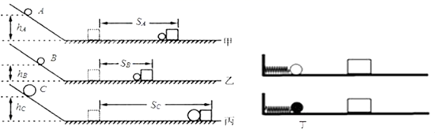

# Physics - 题目 1484

**ID**: e6df63f43d6542e5a35085759441629a
**年级**: Grade 9
**难度**: Medium-Hard
**题型**: Experiment

## 题目
为了模拟研究汽车超载和超速带来的安全隐患，小勇同学设计了如图所示的探究实验：将A、B、C三个小球先后从同一装置高分别为h_{A}、h_{B}、h_{C}的位置滚下（m_{A}＝m_{B}＜m_{C}，h_{A}＝h_{C}＞h_{B}），推动小木块运动一段距离后停止，请你根据生活经验和所学的物理探究方法，回答：（1）在图甲和图丙实验中，A球、C球刚滚到水平面时的速度．（选填“相等”或”不相等）（2）用来研究超载安全隐患时，我们应选择两个图所示实验进行比较．（3）用来研究超速安全隐患时，我们应选择两个图所示实验进行比较．（4）实验中，小球碰撞木块后，小球和木块继续在水平木板上滑动一段距离后停下，设碰撞前一瞬间小球的动能为E，小球推动木块所做的功为W，则EW（选填“＜”、“＞”或“＝”）．（5）后来小勇将实验改装成用形状相同的塑料球和铁球（铁球质量大）将弹簧压缩到相同程度后再放手，如图丁所示，两球离开弹簧时的速度．（选填“相同”或“不相同”），纸盒被推开的距离（选填“相同”或“不相同“）．​​​​​​​‌

## 解答

1. （1）小球从同一高度释放，运动到水平面时，它们的速度相等；
2. （2）超载是指汽车的速度一定时，质量越大动能越大．选择到达水平面的速度相等，质量不同的甲、丙小球进行实验，即采用甲、丙两图实验．
3. （3）超速是指汽车的质量一定，速度越大，动能越大．选择质量相等到达水平面速度不同的甲、乙小球，即采用甲、乙两图实验．
4. （4）球与木块碰撞的过程中，球对木块做功，做功的大小小于球最初的动能；木块在运动过程中，克服摩擦做功，机械能转化为内能，即木块克服摩擦做的功等于木块的动能大小，也就是小于碰撞前小球的动能；
5. （5）用形状相同的塑料球和铁球将弹簧压缩到相同程度，弹簧的弹性势能相同，转化成的动能相同，两小球的质量不同，所以速度不同，但由于动能相同，对纸盒做的功应相同，对纸盒做得功是克服水平面给纸盒的摩擦力做功，摩擦力是相同的，根据 $W=Fs$ 可知，纸盒运动的距离也应该是相同的．
6. 故答案为（1）相等；（2）甲、丙；（3）甲、乙；（4）＞；（5）不相同；相同．
7. 【点睛】
8. （1）掌握动能、重力势能、弹性势能的影响因素．
9. （2）掌握动能和重力势能的相互转化．
10. （3）掌握做功的两个必要因素，并能判断是否做功．

## 知识点

**中文**:
  - 探究影响物体动能大小因素的实验

**English**:
  - Experiment: Factors Affecting Kinetic Energy

---
