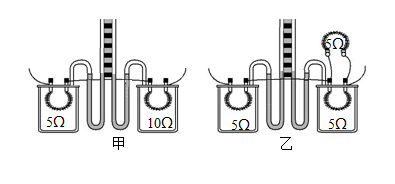

# Physics - 题目 771

**ID**: ea89c30bed294981bc163475b88755bc
**年级**: Grade 9
**难度**: Medium-Hard
**题型**: Experiment

## 题目
学习了焦耳定律之后，小林想通过实验再次探究一下“电流产生的热量与哪些因素有关”请你和小林一起完成下面的实验：如图甲所示的实验装置，两个相同的透明容器中密封着质量相等且初温相同的空气。​​​​​​​‌当电阻通电发热后，容器中的空气受热膨胀，再通过液柱的高度差反映出产热的多少：(1)用甲图装置可以探究电流产生的热量与的关系，实验现象是边的液柱比较高；(2)图乙中容器外并联了一个阻值相同的电阻丝，其目的是为了使两个容器中的不同，最后得出的结论是。

## 解答

1. (1)[1][2]甲图装置中，两电阻串联串联，通过的电流相等，通过时间也相同，根据控制变量法，可以探究电流产生的热量与电阻的关系。甲图右杯中电阻较左杯中的电阻大，二者电流两等、通电时间相等，由焦耳定律 $Q=I{^{2}}Rt$ 可知右杯中产生的热量多，故实验现象是“右边的液柱比较高”。
2. (2)[3][4]图乙中容器外并联了一个阻值相同的电阻丝，根据并联电路电流的规律，其目的是为了使两个容器中的电流不同 $($ 通过左侧容器中电阻丝的电流大 $)$ ，由乙图知左管中高度差大，根据转换法，左容器中电阻丝产生的热量多，故最后得出的结论是电阻与通电时间一定时，电流越大产生的热量越多。

## 知识点

**中文**:
  - 影响电流热效应因素的探究实验

**English**:
  - Experiment: Factors Affecting Heating Effect

---
