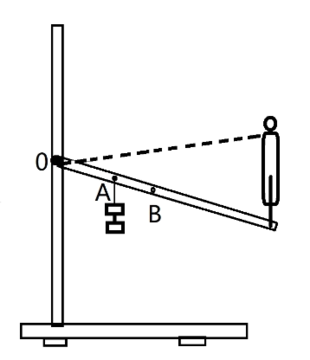

# Physics - 题目 2510

**ID**: ecb037eebe4146eaae3874081ac1271c
**年级**: Grade 9
**难度**: Medium-Hard
**题型**: Experiment

## 题目
小明同学利用如图所示的实验装置探究杠杆的机械效率。​​​​​​​‌请你完成下列问题：(1)实验过程中，要竖直向上匀速缓慢拉动弹簧测力计，这样做的目的是；(2)为了进一步研究杠杆的机械效率与哪些因素有关，小明同学用该实验装置，先后将钩码挂在A、B两点，测量并计算得到如表格中所示的两组实验数据：次数钩码悬挂点钩码总重G钩码运动距离h拉力F测力计移动距离s机械效率 $η$1A1.5N0.10m0.7N0.30m71.4%2B2.0N0.15m1.2N0.30m83.3%根据表格中的实验数据可知：使用该杠杆提升钩码做功时，也存在额外功，不计空气阻力，其额外功的主要来源是：①；②；(3)根据表格中的实验数据不能得出：杠杆的机械效率与所挂钩码的重量有关，钩码越重其效率越高的实验结论。其理由是：①；②；(4)小明在上述实验中，如果保持钩码的重量及其悬挂点不变，只将弹簧测力计改为始终垂直杠杆向上匀速拉动，则在钩码不断被提升的过程中，弹簧测力计的示数将（选填“变大”、“变小”或“不变”）。

## 解答

1. (1)[1]实验时，竖直向上匀速拉动弹簧测力计，使弹簧测力计的示数和作用在杠杆上的拉力相等。
2. (2)①[2]克服杠杆的重力做功。
3. ②[3]克服支点与杠杆的摩擦阻力做功。
4. (3)①[4]分析机械效率的影响因素采用控制变量法，研究提起的物重与机械效率的关系时，应保持位置不变。
5. ②[5]应进行多次实验，分析多组数据，才能得出正确结论，只凭一次实验数据做出结论具有偶然性，不具普遍性。
6. (4)[6]如果保持钩码的重量及其悬挂点不变，只将弹簧测力计改为始终垂直杠杆向上匀速拉动，拉力的力臂不变，钩码所受的重力不变，阻力力臂变大，由杠杆平衡条件 $F{{}_{1}}l{{}_{1}}=F{{}_{2}}l{{}_{2}}$ 知，拉力将变大。

## 知识点

**中文**:
  - 杠杆的机械效率及其计算

**English**:
  - Mechanical Efficiency of Levers and Calculations

---
