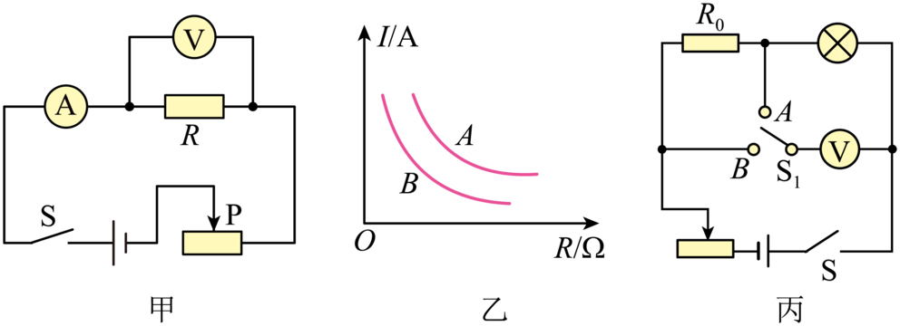

# Physics - 题目 1180

**ID**: f10d2071b4bf40df970fa380e401706c
**年级**: Grade 9
**难度**: Medium-Hard
**题型**: Experiment

## 题目
小安在探究“电流与电阻的关系”的实验中，设计的电路如图甲所示。​​​​​​​‌（1）小安连接好电路，闭合开关后，发现电流表没有示数。移动滑动变阻器的滑片，电压表示数始终接近电源电压。造成这一现象的原因可能是_（填选项）；

## 解答

1. （1）A．若电流表断路，整个电路断开，电压表也不会有示数，不符合电压表示数始终接近电源电压的现象故A不符合题意；
2. B．若滑动变阻器短路，电路中电阻变小，电流会变大，电流表会有示数， 故B不符合题意；
3. C．若定值电阻断路，电路处于断路状态，电流表没有示数，而电压表并联在电源两端，所以电压表示数始终接近电源电压故C符合题意；
4. D．若定值电阻短路，电路中有电流，电流表有示数，电压表被短路，示数为0故D不符合题意。
5. （2）在探究“电流与电阻的关系”实验中，要控制定值电阻两端的电压不变。根据串联电路的分压原理 $\frac {U{{}_{1}}}{U{{}_{2}}}=\frac {R{{}_{1}}}{R{{}_{2}}}$ ，当把定值电阻由低电阻更换为高电阻时，定值电阻两端的电压会变大。为了使定值电阻两端电压不变，应增大滑动变阻器接入电路的电阻，即将滑动变阻器的滑片P向左移，这样做的目的是控制定值电阻两端的电压不变。
6. （3）在探究“电流与电阻的关系”实验中，要控制电阻两端的电压不变。根据欧姆定律 $I=\frac {U}{R}$ ，若 $I-R$ 图像不重合，说明在改变电阻时，电阻两端的电压不同。因为不同的 $I-R$ 图像对应的是不同的电阻两端电压值，所以其原因是：没有控制电阻两端的电压相同。
7. （4）当闭合开关 ${\rm S}$ ，将 ${\rm{S}}{{}_{1}}$ 拨到触点 $\mathrm{A}$ ，移动滑片，使电压表的示数为 $U{{}_{1}}$ ，此时小灯泡正常发光，电压表测小灯泡两端电压。保持滑片的位置不动，再将开关 ${\rm{S}}{{}_{1}}$ 拨到另一触点 $B$ ，读出电压表示数 $U{{}_{2}}$ ，此时电压表测小灯泡和定值电阻 $R{{}_{0}}$ 两端的总电压。那么定值电阻 $R{{}_{0}}$ 两端的电压 $U{{}_{0}}=U{{}_{2}}-U{{}_{1}}$ ，根据欧姆定律 $I=\frac {U}{R}$ ，此时电路中的电流 $I=I{{}_{0}}=\frac {U{{}_{0}}}{R{{}_{0}}}=\frac {U{{}_{2}}-U{{}_{1}}}{R{{}_{0}}}$
8. 因为串联电路电流处处相等，这个电流也是小灯泡正常发光时的电流。已知小灯泡正常发光时的电压为 $U{{}_{1}}$ ，根据欧姆定律 $R=\frac {U}{I}$ ，则小灯泡正常发光时电阻 $R=\frac {U{{}_{1}}}{I}=\frac {U{{}_{1}}}{\frac {U{{}_{2}}-U{{}_{1}}}{R{{}_{0}}}}=\frac {U{{}_{1}}R{{}_{0}}}{U{{}_{2}}-U{{}_{1}}}$

## 知识点

**中文**:
  - 其他方法测电阻
  - 电流与电阻关系的探究实验

**English**:
  - Other Methods for Measuring Resistance
  - Experiment: Relationship between Current and Resistance

---
