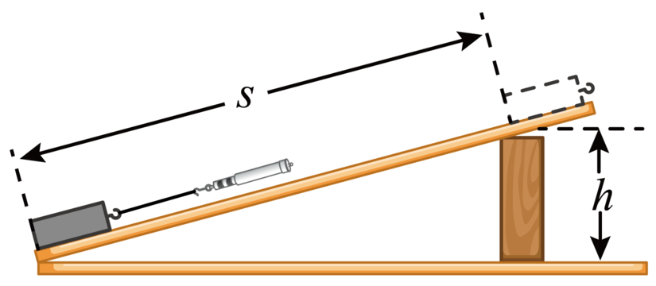

# Physics - 题目 4

**ID**: f45f44df46914f7a965d46307bdb0f26
**年级**: Grade 9
**难度**: Medium-Hard
**题型**: Experiment

## 题目
下图是小明同学探究斜面机械效率跟什么因素有关的实验装置。​​​​​​​‌实验时他用弹簧测力计拉着同一物块沿粗糙程度相同的斜面向上做匀速直线运动。实验的部分数据如下：实验次数斜面的倾斜程度物块重量G/N斜面高度h/m沿斜面拉力F/N斜面长s/m机械效率1较缓100.15.012较陡100.36.7145%3最陡100.58.4160%（1）小明探究的是斜面的机械效率跟的关系。第1次实验中，斜面的机械效率为；（2）分析表格中数据可以得出结论：在斜面粗糙程度相同时，斜面越陡，机械效越。若要探究斜面机械效率跟斜面的粗糙程度的关系，应保持不变；（3）分析表格中拉力数据，可以得出结论：斜面越陡，越不（选填“省力”或“费力”）。

## 解答

1. （1）[1]题中保证了斜面的粗糙程度一定，斜面的倾斜程度不同，所以小明是探究斜面机械效率和斜面倾斜程度的关系。
2. [2]第一次实验的机械效率为
3. $η=\frac {W{{}_{有}}}{W{{}_{总}}}\times 100\%=\frac {Gh}{Fs}\times 100\%=\frac {10{\rm{N}}\times 0.1{\rm{m}}}{5{\rm{N}}\times 1{\rm{m}}}\times 100\%=20\%$
4. （2）[3]根据表中数据可以得出结论：在斜面粗糙程度相同时，斜面越陡，机械效率越高。
5. [4]根据控制变量法原理可知：要探究斜面机械效率和斜面粗糙程度的关系，就要控制斜面的倾斜程度一定。
6. （3）[5]根据表格中的数据可知，斜面越陡，拉力越大，越不省力。

## 知识点

**中文**:
  - 斜面的机械效率及其计算

**English**:
  - Mechanical Efficiency of Inclined Planes and Calculations

---
