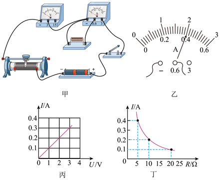

# Physics - 题目 2358

**ID**: f874ad765060439797f9a43f3cd4603e
**年级**: Grade 9
**难度**: Medium-Hard
**题型**: Experiment

## 题目
在“探究电流与电压、电阻的关系”实验中，已知电源电压为6V且保持不变：（1）在“探究电流与电压的关系”的过程中，小明连接了如图甲所示的实物电路，通电前检查发现电路接错了，只要改接一根导线就可以使电路连接正确，请把接错的那一根导线找出来打上“×”，再画出正确的连接；（2）电路改正后，实验过程中滑动变阻器的作用是：①保护电路，②；（3）小明根据实验数据绘制了 $I-U$ 和 $I-R$ 的图像，如图丙、丁所示，由图像丙可以得到的实验结论是：；（4）在“探究电流与电阻的关系”的过程中，实验用到的电阻阻值分别为5Ω、10Ω、15Ω、20Ω、25Ω。​​​​​​​‌①先把5Ω电阻接入电路，闭合开关，调节滑动变阻器，记录电流表示数；②将5Ω电阻换成10Ω电阻，闭合开关后，发现电压表示数变化了，应移动滑动变阻器的滑片，当观察到电压表示数为V时，记录电流表示数；③将10Ω电阻换成15Ω电阻，闭合开关后发现：滑动变阻器的滑片不管如何移动，电压表的示数都无法达到指定电压，为了使题中5个定值电阻均能完成上述实验，滑动变阻器的最大阻值应不小于Ω。

## 解答

1. （1）在“探究电流与电压的关系”的过程中，电压表应测导体的两端电压，电流表测通过导体的电流，图中，电压表串联在电路中，是错误的；改接情况如图所示：
2. 
3. （2）在“探究电流与电压的关系”的过程中，滑动变阻器的作用除了保护电路，还可以改变通过电阻的电流和电阻两端的电压。
4. （3）根据图丙电阻的I-U图像，可以看出图像是一条倾斜直线，说明导体的电阻一定，通过导体的电流与导体两端的电压成正比。
5. （4）②由图丁可知，电阻两端保持的电压值为U=0.4A×5Ω=0.2A×10Ω=0.1A×20Ω=2V，因此将5Ω电阻换成10Ω电阻，闭合开关后，发现电压表示数变化了，应移动滑动变阻器的滑片，当观察到电压表示数为2V时，记录电流表示数；③根据串联分压原理可得 $\frac {R}{R{{}_{滑}}}{\rm{=}}\frac {U{{}_{{\rm{R}}}}}{U{{}_{滑}}}{\rm{=}}\frac {{{2}}{\rm{V}}}{{{6}}{\rm{V}}{{-}}2{\rm{V}}}{\rm{=}}\frac {{{1}}}{{{2}}}$ ，当R=25Ω时， $\frac {25\Omega }{R{{}_{滑}}}{\rm{=}}\frac {{{1}}}{{{2}}}$ ，解得 $R{{}_{滑}}{\rm{=}}50\Omega $ ，因此滑动变阻器的最大阻值应不小于50Ω。

## 知识点

**中文**:
  - 电流与电压关系的探究实验
  - 电流与电阻关系的探究实验

**English**:
  - Experiment: Relationship between Current and Voltage
  - Experiment: Relationship between Current and Resistance

---
