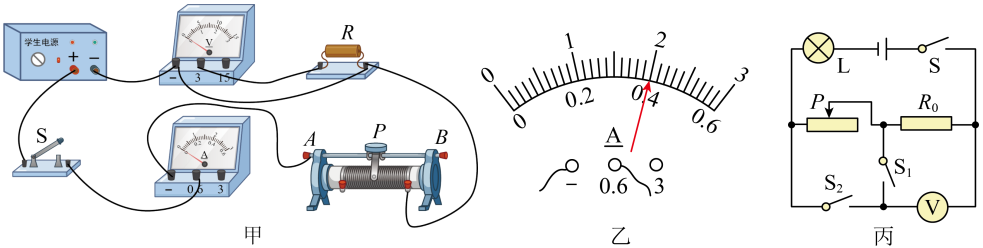

# Physics - 题目 2946

**ID**: f9eaff554c3e44d686e7883003ff8764
**年级**: Grade 9
**难度**: Medium-Hard
**题型**: Experiment

## 题目
小明同学使用可调电压的电源、四个定值电阻（阻值分别为5Ω、10Ω、20Ω、25Ω）、电压表、电流表、标有“20Ω　1A”的滑动变阻器、开关和导线等器材探究“电流和电阻的关系”。​​​​​​​‌（1）小明连接如图甲所示的电路，检查电路发现有一条导线连接错误，请在图甲中的错误导线上画“×”，并用笔画线代替导线将电路连接正确；（2）排除故障后，当接入5Ω定值电阻时，调节滑动变阻器的滑片到某位置，电流表的示数如图乙所示。依次更换定值电阻进行实验，当接入20Ω定值电阻时，调节滑动变阻器的滑片，使电压表的示数保持V不变，此时滑动变阻器接入电路的阻值恰好达到最大值；（3）将20Ω的电阻更换成25Ω的电阻时，为完成实验，应该将电源电压调（选填“大”或“小”），使电压表的示数恢复到控制电压，通过分析实验数据得出结论：在电压一定时，通过导体的电流与导体的电阻成比；（4）小明在完成上述实验后，想测量小灯泡两端的电压为 $U{{}_{0}}$ （ $U{{}_{0}}<U{{}_{额}}$ ）时的电阻。他取来一个小灯泡L，已知其额定电压为 $U{{}_{额}}$ 、额定电流为 $I{{}_{额}}$ ，连接了如图丙所示的电路。已知定值电阻的阻值为 $R{{}_{0}}$ ，电源电压未知。请完成下列实验步骤：①只闭合开关S、S_{1}，调节滑动变阻器的滑片P，使电压表的示数为时，小灯泡L正常发光；②保持滑动变阻器滑片的位置不变，只闭合开关S、S_{2}，读出电压表的示数为U_{1}；接着调节滑动变阻器的滑片P，使电压表的示数为，则小灯泡L两端的电压达到 $U{{}_{0}}$ ；③接着断开开关S_{2}，闭合开关S_{1}，读出电压表的示数为 $U{{}_{2}}$ ；④小灯泡L两端的电压为 $U{{}_{0}}$ 时的电阻的表达式：R=（用测量量和已知量表示）。

## 解答

1. （1）电路中，应当将电源、开关、滑动变阻器、定值电阻和电流表串联，将电压表并联在定值电阻两端，分析电路图可知，图中定值电阻和电压表被短路，将滑动变阻器右下接线柱与电阻R右接线柱相连的导线，改接到电阻R的左接线柱上。
2. （2）由图乙可知，当接入5Ω定值电阻时，电流表选用0~0.6A量程，分度值为0.02A，电流表的示数为0.4A，则通过5Ω定值电阻的电流为0.4A；因为探究电流与电阻的关系时，需保持定值电阻两端的电压不变，则接入20Ω定值电阻时，调节滑动变阻器的滑片，使电压表的示数保持为 $U=IR=0.4{\rm{A}}\times 5{\rm{Ω}}=2{\rm{V}}$ 。
3. （3）接入20Ω电阻时，滑动变阻器接入电路的阻值恰好达到最大值，则电源电压 $U{{}_{电源}}=U+U{{}_{滑大}}=U+I{{}_{定}}R{{}_{滑大}}=2{\rm{V}}+\frac {2{\rm{V}}}{20{\rm{Ω}}}\times 20{\rm{Ω}}=4{\rm{V}}$ ；根据串联分压可知，将20Ω电阻更换成25Ω电阻时， $\frac {U{{}_{定}}}{U{{}_{滑}}}=\frac {R{{}_{定}}}{R{{}_{滑}}}=\frac {25{\rm{Ω}}}{20{\rm{Ω}}}=\frac {2{\rm{V}}}{U{{}_{滑}}}$ ，解得滑动变阻器两端的电压 $U{{}_{滑}}=1.6{\rm{V}}$ ，根据串联电路的电压特点可知， $U{{}_{电源}}{\rm{^{′}}}=U+U{{}_{滑}}=2{\rm{V}}+1.6{\rm{V}}=3.6{\rm{V}}$ ，由于 $U{{}_{电源}}>U{{}_{电源}}{\rm{^{′}}}$ ，所以应将电源电压调小。通过分析实验数据可知，电流随电阻的增大而减小，电流与电阻的乘积不变，所以可以得出结论：在电压一定时，通过导体的电流与导体的电阻成反比。
4. （4）①分析电路图可知，只闭合开关S、S_{1}，定值电阻、滑动变阻器和灯泡串联，电压表测定值电阻两端的电压，为了使灯泡正常工作，根据串联电路的电流特点，使电压表的示数为 $I{{}_{额}}R{{}_{0}}$ 。
5. ②保持滑动变阻器滑片的位置不变，只闭合开关S、S_{2}，定值电阻、滑动变阻器和灯泡串联，电压表测定值电阻和滑动变阻器两端的电压，读出电压表的示数为U_{1}；根据串联电路的电压特点可知，电源电压为U_{1}+U_{额}；接着调节滑动变阻器的滑片P，使电压表的示数 $U{{}_{{\rm{V}}}}=U{{}_{1}}+U{{}_{额}}-U{{}_{0}}$ ，则小灯泡L两端的电压达到U_{0}。
6. ④接着断开开关S_{2}，闭合开关S_{1}，定值电阻、滑动变阻器和灯泡串联，电压表再次测定值电阻两端的电压，读出电压表的示数为U_{2}；根据欧姆定律及串联电路的电流特点可知，此时通过小灯泡的电流 $I{{}_{{\rm{L}}}}=I{{}_{0}}=\frac {U{{}_{2}}}{R{{}_{0}}}$ ，则小灯泡L两端的电压为U_{0}时的电阻 $R=\frac {U{{}_{0}}}{I{{}_{{\rm{L}}}}}=\frac {U{{}_{0}}}{\frac {U{{}_{2}}}{R{{}_{0}}}}=\frac {U{{}_{0}}}{U{{}_{2}}}R{{}_{0}}$ 。

## 知识点

**中文**:
  - 其他方法测电阻
  - 电流与电阻关系的探究实验

**English**:
  - Other Methods for Measuring Resistance
  - Experiment: Relationship between Current and Resistance

---
