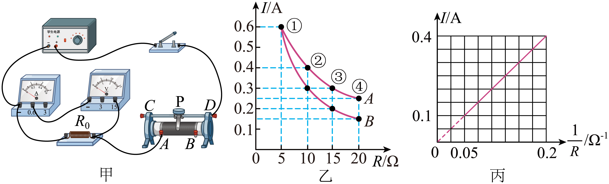

# Physics - 题目 2724

**ID**: fd8fe636252446e28d876e6875c09cf2
**年级**: Grade 9
**难度**: Medium-Hard
**题型**: Experiment

## 题目
实验小组用如图甲所示的电路“探究电流与电阻的关系”，所用器材有学生电源、定值电阻  $R{{}_{0}}$ （分别为5Ω、10Ω、15Ω、20Ω）、电压表、电流表、滑动变阻器，导线若干。​​​​​​​‌（1）按图甲连接电路后，闭合开关，发现表无示数；经检查发现电路中有一根导线连接错误，请在错误的线上打“×”，并用笔画线代替导线将电路连接正确；（2）实验中A、B两个小组分别根据实验数据画出I-R图像，如图乙所示，由图可知，操作错误的是组；你作出该判断的理由是；（3）C组同学根据实验数据得到如图丙所示的 $I{{-}}\frac {1}{R}$ 图像；①分析图像可得电流与电阻的关系：在电压一定时，；②图像表明在实验过程中，C组的电压表示数始终控制为V；③请在丙图中描出定值电阻为10Ω时对应的坐标点；（4）若实验所用的滑动变阻器规格为“20Ω　1A”，所选电压表量程为“0~3V”，则为了使以上四个电阻分别接入电路时都能完成实验，电源电压不能超过V。

## 解答

1. （1）按图甲连接电路后，闭合开关，此时电流表被短路，因此会发现电流表无示数。
2. 电流表应串联在电路中，测量电路电流，所以应将定值电阻的左接线柱与电流表的“0.6”接线柱连接，如图所示：
3. 
4. （2）由图乙图像数据分析可得，A组定值电阻的两端电压 $U{{}_{{\rm{V}}{\rm{A}}}}{\rm{=}}{{0}}{{.}}{{6}}{\rm{A}}\times 5\Omega \ne {{0}}{{.}}{{4}}{\rm{A}}\times 10\Omega \ne {{.}}{{.}}{{.}}\ne {{0}}{{.}}{{3}}{\rm{A}}\times 15\Omega $ 不是一个定值；B组定值电阻的两端电压 $U{{}_{{\rm{V}}{\rm{B}}}}{\rm{=}}{{0}}{{.}}{{6}}{\rm{A}}\times 5\Omega {\rm{=}}{{0}}{{.}}{{3}}{\rm{A}}\times 10\Omega {\rm{=}}{{.}}{{.}}{{.}}{\rm{=}}{{0}}{{.}}{{2}}{\rm{A}}\times 15\Omega {\rm{=}}3{\rm{V}}$ 是一个定值；实验是探究电流与电阻的关系，根据控制变量法可知，需控制定值电阻的两端电压不变，所以操作错误的是A组；理由是：没有控制定值电阻两端的电压一定。
5. （3）①由图丙可知，在电压一定时， $I{{-}}\frac {1}{R}$ 图像是一条倾斜的直线，因此I与 $\frac {1}{R}$ 成正比，说明I与R成反比，即：在电压一定时，电流与电阻成反比；②由图丙可知，当 $\frac {1}{R}{\rm{=}}0.2\Omega {^{-1}}$ 即R=5Ω时，I=0.4A，所以电压表示数为 $U{\rm{=}}IR{\rm{=}}0.4{\rm{A}}{\rm{×}}{{5}}{\rm{Ω}}{\rm{=}}2{\rm{V}}$ ，即为C组的电压表控制不变的示数为2V；③当定值电阻为10Ω时，其倒数为 $\frac {1}{10\Omega }{\rm{=}}0.1\Omega {^{-1}}$ ，即为定值电阻为10Ω时对应的坐标点的横坐标；通过定值电阻的电流为 $\frac {2{\rm{V}}}{10\Omega }{\rm{=}}0.2{\rm{A}}$ ，即为定值电阻为10Ω时对应的坐标点的纵坐标；如图所示：
6. 
7. （4）当电阻R″=20Ω时，电压表示数最大为3V，根据欧姆定律可知，此时电流为 $I^{′′}{{\rm{=}}}\frac {3{\rm{V}}}{20\Omega }{\rm{=}}0.15{\rm{A}}$ ，因为滑动变阻器的最大阻值为20Ω，根据串联电路特点，所以滑动变阻器分得的最大电压为3 V，故电源电压最大为3V+3V=6V。

## 知识点

**中文**:
  - 电流与电阻关系的探究实验

**English**:
  - Experiment: Relationship between Current and Resistance

---
