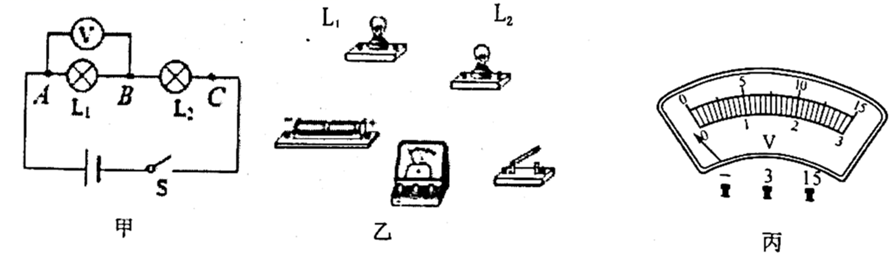

# Physics - 题目 2730

**ID**: ffc71f8ccd8044548fe4ff281a6a1531
**年级**: Grade 9
**难度**: Medium-Hard
**题型**: Experiment

## 题目
如图所示是小丽“探究串联电路电压的规律”的实验：(1)在图乙中按图甲所示电路图连接实验电路（要求导线不能交叉）。​​​​​​​‌(2)她在开关闭合前发现电压表的指针位置如图丙所示，接下来她要对电压表进行的操作是。(3)小丽连好电路，用开关试触时发现只有一盏灯发光，且电压表无示数，则故障原因是。(4)小丽在改接电路时，保持电压表的B连接点不动，只断开A连接点，并改接到C连接点上，测量L_{2}两端电压。她能否测出L_{2}两端电压？理由是。实验次数U_{AB}/VU_{BC}/VU_{AC}/V第一次0.82.23第二次1.02.03第三次1.21.83(5)改正错误后，她用电压表分别测量L_{1}两端的电压U_{AB}、L_{2}两端的电压U_{BC}和L_{1}、L_{2}两端的总电压U_{AC}；更换不同灯泡，再做两次实验，将三次测出的电压填入下表。请你根据她的实验过程和有关数据回答下列问题：①分析表格中的数据，得出实验结论是。②在许多实验中都需要进行多次测量，有的是为了找到普遍规律，避免偶然性；有的是为了求平均值以减小误差，下列实验中多次测量的目的与本实验相同的是。（填字母）

## 解答

1. (1)按照电路图顺次连接，如图所示：
2. 
3. (2)由图知，电压表指针没有指在零刻度线上，使用电压表前应对电压表进行调零，使指针指在零刻度线上。
4. (3)灯泡一亮一不亮，说明短路，电压表没示数，说明电压表并联的灯泡短路；故L_{1}短路。
5. (4)保持电压表的B连接点不动，只断开A连接点，并改接到C连接点上，电压表正负接线柱接反，故不能测出L_{2}两端电压。
6. (5)①分析表格中的数据可得
7. U_{AC}=U_{AB}+U_{BC}
8. 即串联电路两端的电压等于各部分电路两端电压之和。
9. ②研究“探究串联电路电压的规律”，多次实验的目的是总结规律，避免因次数太少造成结论的偶然性或片面性；
10. A．测量长度，采用多次测量的目的是，取平均值，减小测量误差，故A不符合题意；
11. B．伏安法测电阻，采用多次测量的目的是，取平均值，减小测量误差，故B不符合题意；
12. C．探究电流与电压的关系，多次测量的目的是，总结规律，防止结论的偶然性，故C符合题意。
13. 故选C。

## 知识点

**中文**:
  - 探究串、并联电路中的电压规律实验

**English**:
  - Experiment: Voltage Laws in Series/Parallel

---
