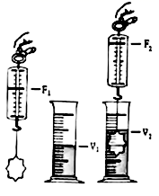
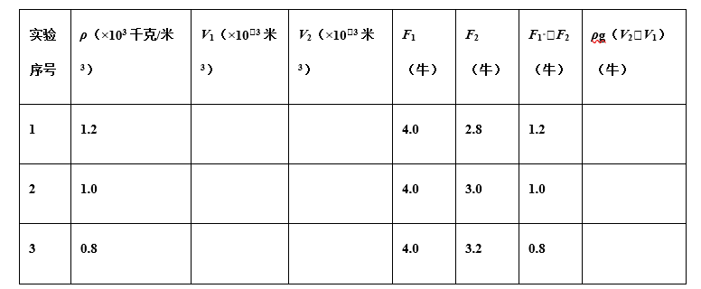

# Physics - 题目 1226

**ID**: ffe084ebf3174e3d8661db88e0777508
**年级**: Grade 9
**难度**: Medium-Hard
**题型**: Experiment

## 题目
小李同学选用弹簧测力计、和系细绳的金属块各一个，及三种密度不同液体进行如图所示实验，设计的实验表格如下。​​​​​​​‌小李同学将测得数据及根据数据计算得到的结果记录在表中（部分未显示）。① 填写所对应的器材，该金属块所受重力为；② 分析实验数据并得出初步结论：a.分析比较实验序号1与2中ρ和F_{2}数据及相关条件可初步得出结论，对浸没在液体中的同一金属块而言，；b.分析比较实验序号1、2、3中ρ和F_{1}F_{2}数据及相关条件可初步得出结论，对浸没在液体中的同一金属块而言，；③ 根据小李同学所设计的表格和实验步骤，该实验的实验目的应该是（填写选项序号）；

## 解答

1. ①[1]在该实验中，需要测量金属块在不同液体中排开的液体的体积，所以需要用到量筒。
2. [2]由图可知，金属块在空气中的重力示数为F_{1}，由表格中的数据可知，金属块的重力为4.0N。
3. ②[3]根据实验序号1与2中ρ和F_{2}数据及相关条件可知，金属块相同，浸没在不同的液体中，弹簧测力计两次示数的差值F_{1}-F_{2}为浮力的大小；液体的密度越小，弹簧测力计示数F_{2}越大，则金属块所受的浮力F_{1}-F_{2}越小，所以实验结论为：对浸没在液体中的同一金属块而言，液体密度越小，弹簧测力计示数F_{2}越大，金属块所受的浮力F_{1}-F_{2}越小。
4. [4]分析比较实验序号1、2、3中ρ和F_{1}-F_{2}数据及相关条件可知：液体的密度ρ越小，弹簧测力计示数之差F_{1}-F_{2}与越小，且弹簧测力计示数之差F_{1}-F_{2}与ρ成正比；故结论为：对浸没在液体中的同一金属块而言，弹簧测力计示数之差F_{1}-F_{2}与ρ成正比。
5. ③[5]实验的过程中，测量的是弹簧测力计示数之差F_{1}-F_{2}即浮力的大小；实验中还测量了金属块排开液体的重力，即
6. $G{{}_{排}}=ρg(V{{}_{2}}-V{{}_{1}})$
7. 所以探究的是浮力与物体排开液体的重力的关系，即探究的是阿基米德原理。
8. 故选A。
9. ④[6]为了得出普遍结论，应该换用不同材料的金属块进行多次实验，从而得到正确的结论。

## 知识点

**中文**:
  - 实验探究阿基米德原理

**English**:
  - Experiment: Investigating Archimedes' Principle

---
