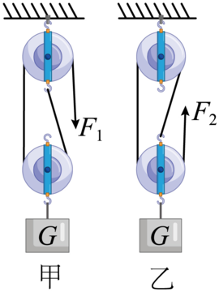

# Physics - 题目 1291

**ID**: 01b18bd9133144f38eb22417c47dd538
**年级**: Grade 9
**难度**: Medium-Hard
**题型**: Fill-in-the-blank

## 题目
如图所示，甲、乙分别为同一滑轮组的不同绕法，忽略绳重及摩擦，分别用两种绕法匀速提升相同重物时，拉力F1F2；甲图绕法滑轮组的机械效率乙图绕法滑轮组的机械效率（以上两空均填“大于”、“等于”或“小于”）。​​​​​​​‌为了能实现匀速拉动，可以使用电动机拉动绳子，电动机的工作原理是通电导体在中受力运动。

## 解答

1. [1]由图可知，甲图中绳子承重段数n1=2，乙图中绳子承重段数n2=3，又因为忽略绳重及摩擦，所以根据公式 $F=\frac {1}{n}(G{{}_{动}}{\rm{+}}G{{}_{物}})$ 可求出拉力F1和F2分别为
2. $F{{}_{1}}=\frac {1}{n{{}_{1}}}(G{{}_{动}}{\rm{+}}G{{}_{物}})=\frac {1}{2}(G{{}_{动}}{\rm{+}}G{{}_{物}})$
3. $F{{}_{2}}=\frac {1}{n{{}_{2}}}(G{{}_{动}}{\rm{+}}G{{}_{物}})=\frac {1}{3}(G{{}_{动}}{\rm{+}}G{{}_{物}})$
4. 所以拉力F1大于F2。
5. [2] 由题意可知，当忽略绳重及摩擦时，根据公式
6. $η=\frac {W{{}_{有用}}}{W{{}_{总}}}\times 100\%=\frac {G{{}_{物}}h}{G{{}_{物}}h{\rm{+}}G{{}_{动}}h}\times 100\%=\frac {G{{}_{物}}}{G{{}_{物}}{\rm{+}}G{{}_{动}}}\times 100{\rm{\%}}$
7. 可求出甲图的机械效率为： $η{{}_{甲}}=\frac {G{{}_{物}}}{G{{}_{物}}{\rm{+}}G{{}_{动}}}\times 100{\rm{\%}}$ ；乙图的机械效率为： $η{{}_{乙}}=\frac {G{{}_{物}}}{G{{}_{物}}{\rm{+}}G{{}_{动}}}\times 100{\rm{\%}}$ ，所以甲图绕法滑轮组的机械效率等于乙图绕法滑轮组的机械效率。
8. [3] 电动机的工作原理是通电导体在磁场中受力运动。

## 知识点

**中文**:
  - 滑轮组绳子拉力的计算
  - 滑轮（组）的机械效率及其计算
  - 直流电动机的原理

**English**:
  - Calculating Rope Tension in Pulley Systems
  - Mechanical Efficiency of Pulleys and Calculations
  - Principle of DC Motor

---
