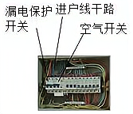

# Physics - 题目 813

**ID**: 032d9d9f8fca43409ee8fd5655876c6a
**年级**: Grade 9
**难度**: Medium-Hard
**题型**: Fill-in-the-blank

## 题目
如图为家庭电路中的供电箱，其中的漏电保护开关在线路漏电时自动断开，空气开关在电路超负荷运行或短路时，自动断开开关。​​​​​​​‌这两个开关（串联/并联）在干路上，以保证用电安全；进户线干路较其它导线特别粗，是为了（增大/减小）电阻，防止进户线干路上通过大电流时发热引起安全事故；带有金属外壳的电水壶用三脚插头，是为了使用时让金属外壳与相连；某同学使用电能表参数为3200imp/（kW•h）的电子式电能表来测量电水壶的功率，他将其余所有用电器关闭，只让电水壶工作，数出电能表指示灯在3min内闪烁了128次，该水壶的实际功率是W，测量结束后，发现电水壶的把手上标注的铭牌为“220V     1000W”请你写出一种造成两个功率存在差异的可能原因：。

## 解答

1. [1]漏电保护开关和空气开关都是串联在干路上，这样在出现电路故障时可以及时断开整个家庭电路。
2. [2]导线越粗，其横截面积越大，同等条件下其电阻就越小，所以进户线干路较其它导线特别粗，是为了减小电阻，以防止进户线干路上通过大电流时发热引起安全事故。
3. [3]带有金属外壳的电水壶用三脚插头，是为了使用时让金属外壳与大地相连，以防止金属外壳的意外带电而造成触电事故的发生。
4. [4]由题意可知，该电水壶工作3min所消耗的电能
5. $W=\frac {1}{3200}{\rm{k}}{\rm{W}}\cdot {\rm{h}}\times 128=0.04{\rm{k}}{\rm{W}}\cdot {\rm{h}}$
6. 该水壶的实际功率
7. $P=\frac {W}{t}=\frac {0.04{\rm{k}}{\rm{W}}\cdot {\rm{h}}}{\frac {1}{20}{\rm{h}}}=0.8{\rm{k}}{\rm{W}}={\rm{8}}{\rm{0}}{\rm{0}}{\rm{W}}$
8. [5]该电水壶的额定功率为 ${\rm{1}}{\rm{0}}{\rm{0}}{\rm{0}}{\rm{W}}$ ，但实际功率只有 ${\rm{8}}{\rm{0}}{\rm{0}}{\rm{W}}$ ，有可能是它的实际工作电压不到220V。

## 知识点

**中文**:
  - 影响电阻大小的因素
  - 电能表的读数及电能的求解
  - 电功率的计算及应用
  - 熔断器的作用及保险丝的选择

**English**:
  - Factors Affecting Resistance
  - Reading Energy Meters and Calculating Energy
  - Calculation and Application of Electric Power
  - Fuses and their Selection

---
